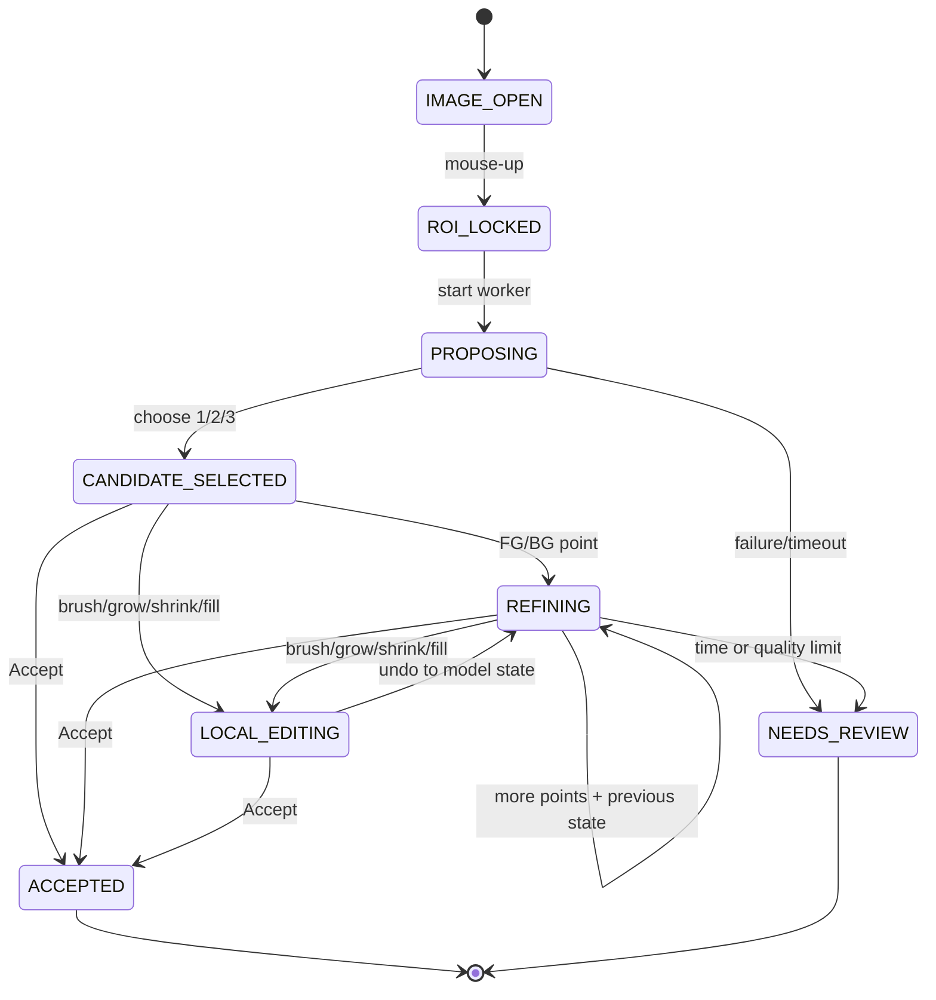

# SegVision Final 開發建議：CPU-first ROI 互動標註 v1

> **文件狀態：已由 [final-development-recommendation.md](./final-development-recommendation.md) 融合取代。**  
> 本檔保留作審查歷史與技術細節參考；工程開工、issue、API 與驗收請以新的單一開工規格為準。

> 狀態：Final development recommendation  
> 日期：2026-08-27  
> 規格權威：`PRD.md` 的凍結決策高於先前策略稿  
> 交付目標：可 `import` 的 Python common function + 薄型本機 GUI

## 0. 文件來源與適用範圍

本文件綜合：

1. `PRD.md`：已凍結的人類決策，為 v1 的最高優先來源。
2. `docs/SAM-assisted-annotation-strategy.md`：長期模型、GUI 與 provider 架構研究。
3. `.ai-staff` 中 Codex / Grok 的方向討論。
4. 三個獨立代理對 CPU 架構、GUI/UX、測試與交付計畫的審查。
5. MobileSAM、EdgeSAM 與原始 SAM 的官方程式碼及授權資料。

Claude artifact URL 在目前工作環境中沒有可連線的瀏覽器，因此無法直接擷取。現有 `.ai-staff` 討論 brief 已指定以 `docs/SAM-assisted-annotation-strategy.md` 作為 Claude 設計稿的本地替代來源。本文件不宣稱已讀取 artifact 頁面內容；若該頁還包含本地文件沒有的決策，開工前必須再做一次 delta review。

## 1. 最終決策

v1 收斂為一條可量測、可保底、CPU-only 的垂直流程：

```text
人框 user ROI
→ 原圖裁出約 10% padding 的工作 crop
→ 單一 CPU 輕量互動分割 backend 編碼一次
→ box prompt 產生最多 3 個候選
→ 人按 1/2/3 選擇
→ 正負點 + previous logits 迭代，不重跑 encoder
→ brush / grow / shrink / fill holes 作最後局部修正
→ 人 Accept 或 Needs Review
→ uncrop 成全圖 binary PNG + versioned JSON sidecar
```

每類固定 CV recipe 是 v1 的條件路徑；文字、VLM、Grounding DINO、DINO patch、SAM 3、HQ-SAM、多模型 streaming 與自動融合全部列為 Later。

第一個可執行 backend 建議使用 `MobileSAM TinyViT + PyTorch CPU` 作 correctness baseline。最終 shipping backend 必須經過目標 Windows CPU bake-off 才能凍結。

## 2. 必須先修正的效能假設

### 2.1 小 ROI 不等於 encoder FLOPs 等比例下降

ROI-first 仍然是正確的操作策略，但原因主要是：

- 隔離干擾背景；
- 讓目標占模型輸入更多像素；
- 讓 box prompt 語意更明確；
- 降低人類檢查與修邊範圍。

不能直接宣稱「ROI 面積縮小多少，CPU encoder 就快多少」。

MobileSAM 官方 `build_sam_vit_t()` 固定 `image_size=1024`，TinyViT 也建為 `img_size=1024`；predictor 會將輸入最長邊 resize 到 encoder 尺寸，之後 pad 成方形。因此來源 crop 是 256、512 或更大時，標準 pipeline 的 encoder 計算尺寸仍大致固定。[MobileSAM build](https://github.com/ChaoningZhang/MobileSAM/blob/master/mobile_sam/build_sam.py)、[MobileSAM predictor](https://github.com/ChaoningZhang/MobileSAM/blob/master/mobile_sam/predictor.py)、[MobileSAM preprocess](https://github.com/ChaoningZhang/MobileSAM/blob/master/mobile_sam/modeling/sam.py)

EdgeSAM 官方 ONNX encoder 同樣明載輸入為 `1×3×1024×1024`。[EdgeSAM ONNX 說明](https://github.com/chongzhou96/EdgeSAM#coreml--onnx-export)

因此 PRD 的 ROI 尺寸建議應作以下解讀：

- `256～512` 是來源 crop 的品質／操作建議，不是已證明的 encoder compute 設定。
- UI 不可只依 ROI 面積顯示「會更慢」；效能警告必須來自實測 cost table。
- 大 ROI 可以警告「目標有效解析度可能不足」；只有 benchmark 證明時才能同時警告 latency。
- 不可直接把固定 1024 權重改成 512 輸入。位置資訊、prompt encoder、輸出 parity 與品質都需重新驗證。

### 2.2 ROI 仍是 v1 必要能力

上述修正不推翻 ROI。v1 的 `<30 秒` 應依靠：

- 輕量 encoder；
- 每個 crop 只 encode 一次；
- decoder-only refine；
- 最多三個候選讓人快速選；
- 兩輪內修不好就切 local edit；
- 不等待文字或 DINO 等慢路徑。

## 3. 模型與授權決策

### 3.1 建議的 baseline

先實作：

```text
MobileSAM TinyViT
+ PyTorch CPU
+ 官方 SAM-compatible predictor semantics
+ box / point / mask prompt
+ native multimask
```

原因：

- 官方實作與原始 SAM 互動契約相近；
- 適合作為 encode-once / decode-many 的 correctness baseline；
- repository 使用 Apache-2.0。[MobileSAM license](https://github.com/ChaoningZhang/MobileSAM/blob/master/LICENSE)

程式碼授權、checkpoint、model card 與轉換後模型仍應在 manifest 中分開記錄。

### 3.2 不直接承諾完整 MobileSAM ONNX

MobileSAM 官方 `scripts/export_onnx_model.py` 接收 image embeddings，主要匯出 prompt encoder + mask decoder，不代表完整 TinyViT encoder 已有官方 ONNX deployment。[官方 export script](https://github.com/ChaoningZhang/MobileSAM/blob/master/scripts/export_onnx_model.py)

若自行匯出完整 encoder，必須另外驗證：

- PyTorch / ONNX mask parity；
- box、多候選、mask prompt 與 previous logits；
- preprocessing / postprocessing 一致性；
- cold start、encoder、decoder 與記憶體；
- exporter 程式與生成檔案的授權。

### 3.3 EdgeSAM 暫不進公司 v1

EdgeSAM 技術上提供完整 encoder / decoder ONNX，但官方 S-Lab License 只允許 non-commercial use，商業用途需聯絡作者。因此未取得書面許可前，不可成為公司 v1 backend。[EdgeSAM license](https://github.com/chongzhou96/EdgeSAM/blob/master/LICENSE)

另外 EdgeSAM 官方說明其 IoU prediction 不可靠，應使用 stability score。common API 必須將 quality score 視為 provider-specific，而不是統一真實 confidence。

### 3.4 Backend Gate 0

開發前必須指定一台實際目標 Windows CPU，至少記錄：

- CPU 型號、核心數與 RAM；
- Python / PyTorch / ONNX Runtime 版本；
- thread 設定；
- 典型原圖與 ROI 尺寸分布；
- cold model load；
- warm encoder p50 / p90 / p95；
- cached decoder p50 / p95；
- peak RAM；
- boundary 品質與 time-to-accept。

最終只維護一個 shipping backend。PyTorch 與 ONNX 不應同時成為 v1 必須支援的正式路徑。

## 4. v1 範圍裁決

| 項目 | v1 決策 |
|---|---|
| 硬體 | 本機 CPU-only；無 CUDA、無遠端服務依賴 |
| 任務 | 一張圖一塊 binary foreground |
| ROI | user ROI + 約 10% padded crop |
| 模型 | 一個 benchmark 選定的 CPU 輕量 backend |
| 候選 | GUI 最多三張；不足三張不可複製補滿 |
| Refine | 正負點 + selected candidate previous logits；不重算 encoder |
| Local edit | brush、erase、grow、shrink、fill holes |
| CV | 每類固定、版本化、可匯入／匯出的 recipe |
| 融合 | API 可保留純函式；GUI 預設關閉；禁止 OR |
| 輸出 | 全圖 binary PNG + versioned JSON sidecar |
| 品質 | 人 Accept 與 boundary / trimap metric 兩者都記 |
| 失敗 | 明確 Needs Review；不得為趕時間接受壞 mask |

### Out of v1

- GPU worker、WebSocket inference service；
- SAM 2 / SAM 3 作必載 backend；
- VLM / 文字提示熱路徑；
- Grounding DINO、DINO / TokenCut 自動尋點；
- HQ-SAM、FocalClick；
- 預設融合或像素 OR；
- 每張影像調 HSV / Lab slider；
- 多類別 instance UI、影片；
- 自動 Accept；
- COCO RLE / polygon / CVAT adapter；
- 同時維護多個 production inference runtime。

## 5. ROI 與座標契約

必須區分：

- `user_roi`：人畫的物體範圍，也是 SAM box prompt。
- `crop_rect`：`user_roi` 向外 pad 約 10% 後的工作 crop。

不可把 padded `crop_rect` 當成 SAM box prompt，否則 padding 中保留的背景脈絡會被宣告成物體範圍。

建議座標：

```text
Full image coordinates
    ├─ user_roi_full: float XYXY
    └─ crop_rect_full: int half-open XYXY
            ↓ subtract crop origin
Crop coordinates
            ↓ backend-owned resize / normalize / pad
Model coordinates
```

規則：

- 公開 ROI 與 point 一律使用 full-image `(x, y)`。
- rectangle 一律採 half-open `[x0, y0, x1, y1)`。
- 候選 mask 儲存為 crop 原始像素解析度的 `numpy.bool_`。
- backend 自己管理 model resize、pad、prompt transform 與 logits postprocess。
- `commit()` 才建立全圖 mask；crop 外預設為背景。
- 邊界 warning 檢查 `crop_rect`，不是 `user_roi`。mask 碰 user ROI 通常是正常的。

## 6. 最終候選策略

### 6.1 沒有有效 CV recipe

1. 用 `user_roi` 作 box prompt。
2. `multimask_output=True`，取得最多三個原生 masks。
3. 移除空 mask、近乎全滿、違反既有人工提示的候選。
4. 高度重複候選可去重；不足三張就顯示實際數量。
5. raw score 只能在相同 backend 內排序。
6. 顯示推薦、較完整、較貼邊等操作描述；詳細欄才顯示 raw metrics。

### 6.2 安全解讀 grid 正點

不可把 ROI 內規則網格全部當作前景。鬆 ROI 內可能包含背景、洞或其他物件。

建議 bounded prompt sweep：

1. 先產生 box-only 原生候選。
2. 計算候選的 stable intersection。
3. erosion 後取得安全內部區域。
4. 僅從安全區選 1～2 個分散點，作為另一個 prompt variant。
5. 將 variant 加入內部 candidate pool，再裁到最多三張。
6. 第一個人工 click 出現後，停止使用 auto-grid；人的點優先。

若 stable interior 為空，直接跳過 grid variant。

### 6.3 黃色不確定帶

v1 不需要多模型分群系統。只需保存：

```python
UncertaintyLayers(
    disagreement_mask_roi=shown_union & ~shown_intersection,
    crop_edge_risk_mask_roi=crop_edge_contact,
)
```

GUI 可將兩者都畫成黃色，但 sidecar 應區分原因。

## 7. CV recipe 的最終角色

CV recipe 是版本化資料，不是每張影像的臨時控制面板。

```json
{
  "schema_version": 1,
  "recipe_id": "gasket-red-v3",
  "class_id": "gasket",
  "enabled": true,
  "working_long_side": 512,
  "algorithm": "lab_threshold",
  "parameters": {},
  "preprocess": {},
  "postprocess": {
    "open_radius_px": 0,
    "close_radius_px": 0,
    "fill_holes": false
  },
  "quality_gate": {},
  "bridge": {
    "policy": "direct_if_clean_else_mask_prompt"
  }
}
```

要求：

- 每類一份、跨影像沿用；
- runtime 不提供 HSV / Lab sliders；
- import 時驗證 schema major、class 與參數範圍；
- morphology 預設關閉，避免破壞細線與洞；
- kernel 尺寸以標準化 `working_long_side` 定義；
- export / import 只序列化 JSON；檔案 I/O 由 GUI adapter 負責。

CV 結果只有三種：

```text
invalid → 忽略 CV，走 box SAM
coarse  → 轉成 backend mask prompt，不抽成自動正負點
direct  → 成為 cv_direct 候選，可跳過 SAM encoder，但仍需人 Accept
```

SAM 是預設必跑；只有啟用的固定 recipe 通過 `direct` gate 時，才允許在 encode 前跳過 SAM。這是節省固定 1024 encoder 成本的唯一明確 v1 例外。

若 CV 走 `coarse`，最多三個 GUI slot 固定為：

1. 最佳有效 `sam_box`；
2. 幾何差異最大的另一張 `sam_box` 或 safe-grid variant；
3. `sam_cv`。

CV 不可變成第四張候選。

## 8. Common function：最終 API 建議

由於 embedding 與 previous logits 是必要 session state，不建議讓 GUI 自行傳遞可混用的 `embedding_id + mask_logits`。公開一個顯式 session API：

```python
engine = SegVisionEngine(
    backend=backend,
    cache_policy=cache_policy,
)

with engine.start(
    image_rgb=image,          # uint8 [H, W, 3], RGB
    image_id=image_id,
    roi_full=roi,
    class_id=class_id,
    recipe=recipe,
) as session:
    proposal = session.propose()

    current = session.refine(
        candidate_id=proposal.candidates[0].id,
        new_points=[
            PointPrompt(x=x, y=y, polarity="fg", space="full")
        ],
    )

    current = session.edit_local(
        candidate_id=current.id,
        op=BrushOp(...),
    )

    result = session.commit(
        candidate_id=current.id,
        acceptance=AcceptanceMetadata(...),
    )
```

Core 不接受檔案路徑、不自行存檔、不下載模型、不使用隱藏 global cache。

### 8.1 Backend protocol

```python
class InteractiveMaskBackend(Protocol):
    @property
    def identity(self) -> ModelIdentity: ...

    @property
    def capabilities(self) -> BackendCapabilities: ...

    def encode(self, crop_rgb: NDArrayUInt8) -> EncodedCrop: ...

    def decode(
        self,
        encoded: EncodedCrop,
        prompts: PromptBundle,
        previous_mask: MaskState | None,
        multimask_count: int,
    ) -> BackendPrediction: ...

    def mask_prompt_from_binary(
        self,
        encoded: EncodedCrop,
        coarse_mask_roi: NDArrayBool,
    ) -> MaskState: ...

    def release(self, encoded: EncodedCrop) -> None: ...
```

GUI 不知道 logits shape、tensor name、normalization 或 model input shape。

### 8.2 主要回傳型別

```python
Candidate(
    id,
    revision,
    mask_roi,
    source,               # sam_box | sam_safe_grid | sam_cv | cv_direct
    rank_metrics,
    warnings,
    prompts,
    model_identity,
)

ProposalSet(
    session_id,
    revision,
    candidates,           # 0..3
    uncertainty,
    crop_context,
    timings,
)

CommitResult(
    full_image_mask,
    sidecar,              # JSON-serializable；caller 寫檔
)
```

Previous logits / mask state 留在 session 的 opaque candidate state，不交給 GUI 任意回傳。

### 8.3 必要 invariant

- 同一 crop `propose()` 只能 encode 一次。
- `refine()` 必須保留 box、累積人工點與 previous mask state。
- `refine()` 使用 `multimask_output=False`，回單一新候選。
- ROI 改變後 revision `+1`，舊 embedding、候選與 edit 全失效。
- 換圖即使 ROI 相同也必須重新 encode。
- 候選永遠為 0～3 張。
- 第一個人工點出現後，丟棄當輪 fusion 與 auto-grid prompts。
- 第一個 local edit 後不再呼叫模型；若想 refine，必須 undo 回模型候選。
- `commit()` 輸出尺寸必須等於原圖，crop 外為背景。
- common function 回候選；只有人 Accept 後，caller 才能存為 training annotation。

### 8.4 Warning 與 error

Warnings：

```text
EMPTY_MASK
TOUCHES_WORK_CROP_EDGE
LOW_PROVIDER_SCORE
TINY_COMPONENTS
TARGET_OCCUPANCY_LOW
INVALID_RECIPE
```

Typed errors：

```text
InvalidRoi
RecipeSchemaError
RecipeClassMismatch
EmbeddingExpired
StaleRevision
BackendUnavailable
```

低分、空 mask 與邊界接觸通常是可處理 warning，不應全部變成 exception。

## 9. 模組邊界

```text
src/segvision/
├─ core/
│  ├─ api.py
│  ├─ types.py
│  ├─ geometry.py
│  ├─ candidate_policy.py
│  ├─ mask_ops.py
│  └─ recipe.py
├─ runtime/
│  ├─ session.py
│  ├─ embedding_cache.py
│  └─ worker.py
├─ providers/
│  ├─ base.py
│  └─ mobile_sam_torch_cpu.py
├─ cv/
│  └─ fixed_recipe.py
├─ gui/
│  ├─ controller.py
│  ├─ canvas.py
│  └─ panels.py
├─ adapters/
│  └─ png_sidecar.py
└─ benchmarks/
   └─ cpu_backend_bakeoff.py
```

依賴方向：

```text
GUI / adapter → core engine → backend protocol
```

Provider 與 adapter 不可引用 GUI。只有 adapter 處理檔案 I/O。

推論應放在單一 background process，避免 encoder 卡住 GUI event loop。限制 PyTorch / ORT / OpenCV / BLAS thread 數，避免 CPU oversubscription。

## 10. Session 與 GUI 狀態機



`Needs Review` 不可進 training set。它是避免工程師為了 30 秒 KPI 接受壞標註的必要出口。

## 11. 薄 GUI 建議

優先採本機 desktop。PySide6 是合理的初始選擇，因為可直接整合 Python CPU inference 且不需維護 web server；但 GUI framework 不得阻塞 headless core。先做 canvas / overlay spike，若 p95 無法小於 100 ms，再替換 rendering 層，不改 core API。

```text
┌────────────────┬───────────────────────────────┬──────────────────┐
│ Class / Recipe │ 原圖 Canvas                   │ Candidate 1/2/3  │
│ id / version   │ user ROI + crop context       │ thumbnail        │
│ enabled / off  │ selected mask + yellow band   │ source / warning │
│ import/export  │ cursor loupe                   │ model rank       │
├────────────────┴───────────────────────────────┴──────────────────┤
│ ROI | FG | BG | Brush | Erase | ±1 | Fill | Timer | Needs Review│
└──────────────────────────────────────────────────────────────────┘
```

熱鍵完全跟 PRD：

- `1` / `2` / `3`：選候選；
- 左／右鍵：正點／負點；
- `[` / `]`：shrink / grow；
- `F`：fill holes；
- `Z`：undo；
- `Space`：Accept；
- `N`：成功存檔後下一張。

v1 畫面不顯示：文字框、DINO points、HSV sliders、多 provider loading、instance tabs 或預設 fusion。

## 12. 30 秒流程與失敗退路

正式計時定義：

```text
start = roi_locked
end   = accept_clicked 或 needs_review_clicked
```

依序退路：

1. box 主候選不理想：切換另外兩張。
2. 局部漏標／溢出：加入一個正點或負點。
3. 最多兩輪 refine，全部攜帶 previous mask state。
4. 固定 recipe 啟用且條件符合：採 `cv_direct` 或 `sam_cv` slot。
5. 仍不理想：進 brush / grow / shrink / fill holes。
6. 30 秒前仍不能成為 training-quality：Needs Review。
7. backend timeout / exception：允許從空 mask 手畫，或 Needs Review；不可顯示舊 revision 結果。

產品報表必須分開顯示：

- Accept `<30s` rate；
- Needs Review rate；
- timeout / failure rate；
- 錯誤接受率。

不能只統計成功案例，也不能用平均數掩蓋困難影像。

## 13. Sidecar 最小 schema

```json
{
  "schema_version": 1,
  "image_id": "...",
  "image_shape": [1080, 1920],
  "class_id": "gasket",
  "status": "accepted",
  "user_roi_full": [100, 120, 500, 520],
  "crop_rect_full": [60, 80, 540, 560],
  "padding_fraction": 0.1,
  "selected_candidate": {
    "id": "...",
    "rank": 1,
    "source": "sam_box",
    "warnings": []
  },
  "provider": {
    "name": "mobile_sam_torch_cpu",
    "model_version": "...",
    "checkpoint_sha256": "...",
    "runtime_version": "..."
  },
  "recipe": {
    "recipe_id": null,
    "recipe_hash": null
  },
  "prompts_full": [],
  "operations": [],
  "timings_ms": {},
  "hardware": {},
  "metrics": {},
  "accepted_warnings": []
}
```

重要事件：

```text
image_visible
roi_drag_started
roi_locked
encode_started / encode_finished
first_candidate_ready / all_candidates_ready
candidate_selected
refine_started / refine_finished
first_local_edit
accept_clicked / needs_review_clicked
commit_started / commit_finished
next_image
```

PNG 與 sidecar 必須由 adapter 成對、原子性寫出；兩者成功後才允許 `N` 下一張。

## 14. 里程碑與 Exit Gate

### M0：可執行規格與目標 CPU

- 定義洞、陰影、透明、遮擋、斷開區域等邊界規則。
- 指定目標 Windows CPU / RAM / thread policy。
- 蒐集 100～300 張代表性新場景，建立分層 gold subset。
- 建立現有單點 SAM 的時間與 boundary baseline。
- 凍結 boundary metric、trimap 寬度、最低 Accept rate 與 Needs Review policy。
- 驗證 ROI 尺寸對固定 1024 backend latency 的真實關係。

Exit：基線可重跑，且不再以 ROI 面積推測 encoder 時間。

### M1：Core contract + fake backend

- types、geometry、mask ops、recipe schema。
- fake backend 跑通 propose / refine / local edit / commit。
- half-open 座標與資料型別凍結。
- unit tests 完成。

Exit：不下載模型也能測完整 common API。

### M2：MobileSAM CPU headless vertical slice

- MobileSAM PyTorch CPU correctness backend。
- user ROI / crop context。
- encode once、原生多候選、previous logits refine。
- candidate cap、去重、黃色帶與 warnings。
- target CPU benchmark。

Exit：可證明同一 ROI 的 encoder call count 為 1，refine 不增加 encoder 次數。

### M3：薄 GUI + manual fallback

- ROI、候選卡、黃色帶、正負點、undo。
- brush、erase、grow、shrink、fill holes。
- background process、cancel、revision gate。
- Accept / Needs Review。
- PNG + sidecar adapter。

Exit：從 clean image 到可重新載入 annotation 的完整 vertical slice。

### M4：固定 CV recipe

- schema validation、import / export。
- invalid / coarse / direct gates。
- `cv_direct` 與 mask prompt 路徑。
- 無 per-image threshold UI。

Exit：該類 recipe 只有在降低時間／操作且不降低 boundary 品質時才預設啟用。

### M5：驗證、封裝與 beta

- 固定目標硬體 benchmark。
- 內部工程師實際標註研究。
- clean Windows、CPU-only、offline install / launch。
- dependency lockfile、SBOM、third-party notices、model manifest。

Exit：時間、主觀 Accept、客觀 boundary、安裝與授權全部通過。

## 15. 測試矩陣

### Unit

- ROI pad / clamp、影像四邊、奇偶尺寸與 half-open 座標；
- full ↔ crop ↔ model point / box / mask round trip；
- `user_roi` 與 `crop_rect` 不混淆；
- RGB / BGR、dtype、binary mask contract；
- candidate 0～3、去重與 deterministic order；
- disagreement / crop-edge layer；
- `refine()` 累積點與 previous state；
- refine encoder call count 不增加；
- local edit 不呼叫模型；
- revision / cancellation / stale-result rejection；
- CV direct 確實跳過 encoder；
- CV coarse 確實使用 mask prompt；
- recipe JSON round trip、未知版本、class mismatch；
- `commit()` 尺寸、座標與 crop 外背景；
- PNG / sidecar round trip。

### Integration

- fake backend 完整 headless workflow；
- MobileSAM CPU 固定 fixtures regression；
- box-only + safe-grid variant + max three candidates；
- 多輪正負點 refine；
- CV off 時不執行 CV；
- CV on 的 direct / coarse / invalid；
- 第一個人工點清除 auto-grid / fusion；
- local edit 後晚到模型不能覆寫；
- empty、border contact、timeout、exception → manual / Needs Review；
- GUI `1/2/3`、undo、Accept、Needs Review、下一張；
- 儲存後重新載入 full mask 與 sidecar。

### Performance

只在固定目標機器做 wall-clock gate，不用共享 CI 當效能真值：

- cold load / warm encoder / cached decoder；
- overlay / brush input-to-frame；
- CV recipe latency；
- RAM peak / cache eviction；
- p50 / p90 / p95 / max；
- ROI lock → Accept / Needs Review；
- `<30s` Accept rate；
- Needs Review、timeout、錯誤接受率；
- 確認程序沒有 CUDA DLL、網路服務或登入需求。

目標：

- overlay / brush p95 `<100 ms`；
- cached refine p95 盡力 `≤1 s`；
- 首候選 latency 由 Gate 0 實測後凍結，不沿用 GPU `<1 s` 數字。

### Quality / User Study

- 與原始 SAM 單點 baseline 比較；
- boundary distance、boundary F-score 或固定 trimap error；
- 工程師獨立複核「可餵訓練」；
- clicks、strokes、undo、候選 rank、CV 使用、ROI 重畫；
- 只增加模型數量、沒有降低時間／操作或改善品質的功能不進 v1。

## 16. 授權與封裝

建立 `models/manifest.json`，每個模型至少記錄：

```text
source URL
code version
checkpoint URL
SHA-256
code license
weight / model-card license
redistribution policy
conversion tool and version
```

要求：

- 大型權重不直接提交 Git；
- 官方下載後驗 checksum；
- 避免任意 pickle checkpoint，能用安全格式時優先；
- ONNX Runtime 的授權不替模型權重背書；
- PySide6 的 LGPL／商業散布義務需列入 notices；
- 不使用 EdgeSAM 商業部署，除非取得許可；
- X-AnyLabeling GPL 程式只作 UX 參考，不複製進閉源產品；
- 鎖 Python、NumPy、OpenCV、Torch / ORT 版本；
- 不同 OpenCV package 不可重複安裝；
- 產生 lockfile、SBOM 與 `THIRD_PARTY_NOTICES`；
- clean-machine 測試不得需要 CUDA、登入或網路服務。

## 17. 開工前只剩的決策

這些不是模型可以替人決定，必須由專案負責人確認：

1. 目標 Windows CPU 與最低 RAM。
2. 洞、陰影、透明、反光、遮擋與斷開區域的標註規則。
3. gold subset 的 boundary metric、trimap 寬度與及格門檻。
4. `<30 秒` 是每張必須 Accept，還是每張必須在 30 秒內作出 Accept / Needs Review 決定。
5. beta 最低 Accept rate 與最高 Needs Review rate。
6. Claude artifact 是否另有尚未同步到本地文件的決策。

## 18. Definition of Done

v1 只有在以下全部成立才算完成：

- common package 可由其他 Python 工程直接 `import`；
- core 不讀寫檔案、不下載模型、不依賴 GUI；
- CPU-only clean machine 可離線啟動；
- 同一 ROI encode 一次，refine 不重算 encoder；
- GUI 永遠顯示不超過三個候選；
- 第一個人工點使用 previous mask state；
- local edit 後模型不能覆寫結果；
- Accept 與 Needs Review 明確分離；
- 全圖 PNG 與 sidecar 可成對重新載入；
- overlay / brush 達到 `<100 ms` p95；
- time、boundary、Accept 三類指標全部被記錄並通過凍結門檻；
- 所有 runtime、model、checkpoint 與 GUI dependencies 完成授權清單；
- 文字、DINO、SAM 3、HQ-SAM 與融合沒有偷偷進入 v1 熱路徑。

## 19. 最後開發順序

第一個實際開發提交不應是 GUI，也不應同時引入多模型。建議順序：

```text
1. types + geometry + fake backend + tests
2. target CPU benchmark harness
3. MobileSAM PyTorch CPU headless vertical slice
4. candidate policy + refine + local edit + commit
5. background worker + thin GUI
6. PNG / sidecar adapter + telemetry
7. fixed per-class CV recipe
8. internal user study + packaging
9. only then evaluate Later providers
```

這是目前最小、最能驗證 `<30 秒`、也最不會讓研究功能拖垮工程交付的路徑。

## 20. 研究功能的後續入口

當 v1 有真實 failure cohort 與時間紀錄後，才依序考慮：

1. HQ-SAM / focus crop：只處理已知邊界失敗 cohort。
2. DINO / TokenCut：只處理已知漏 component cohort。
3. 文字 / Grounding DINO / SAM 3：只處理語意定位失敗 cohort。
4. 2-of-3 opt-in fusion：只在實測降低修正時間時啟用。
5. 少數類別：重用 ROI 與 embedding 的新版本契約。

每個 Later provider 必須通過同一 gate：降低 time-to-accept 或人工動作，且不降低 boundary 品質；否則不合併。

更廣泛的模型與論文研究請參考 `docs/SAM-assisted-annotation-strategy.md`。
