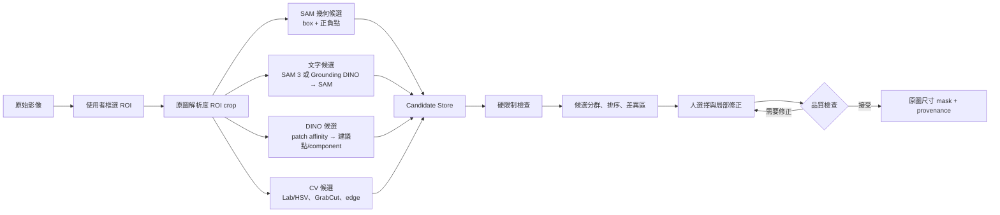

# SegVision：ROI-first 多策略 SAM 靜態影像標註方案

> 狀態：設計建議稿  
> 更新日期：2026-08-27  
> 適用情境：單一前景或少數類別、靜態影像、全新場景、目標每張影像在 30 秒內完成標註

## 1. 結論摘要

本方案不把多個模型輸出的遮罩直接相加，而是建立一個「多來源候選提案 + 人類最後裁決」的標註引擎：

1. 使用者先框出鬆的 ROI，系統保留原始解析度，只裁切目標附近區域進行推論。
2. SAM 幾何提示路徑先提供低延遲主候選。
3. 文字、DINO 特徵與傳統 CV 路徑在背景並行補充候選或建議點。
4. 系統將候選映回原圖、檢查硬限制、分群與排序。
5. 使用者選擇候選，透過正點、負點、brush、erase 或 polygon 快速修正。
6. 提交原圖尺寸的 mask，並保留完整來源與操作紀錄。

第一版的成功標準不是「模型完全自動正確」，而是讓多數影像只需一個 ROI、一次候選選擇與零到兩次修正即可提交。

## 2. 問題定義

### 2.1 使用情境

- 一張圖通常只有一塊主要前景，或只有少數類別。
- 影像是靜態圖，不需要跨影格追蹤。
- 場景可能每次都不同，不能假設有足夠資料預先訓練專用模型。
- 人眼通常可以辨識邊界，但單一 SAM 中心點可能得到錯誤尺度、漏掉部分區域或黏到鄰近物件。
- 操作時間目標為每張少於 30 秒。

### 2.2 必須先定義的標註規則

模型問題之外，工程團隊需要先寫清楚下列規則，否則即使人眼看得見邊界，不同標註者仍可能給出不同答案：

- 只標可見像素，還是推測被遮擋部分？
- 洞、縫隙與內部背景是否要挖空？
- 半透明、反光、陰影與光暈是否屬於前景？
- 斷開但語意上屬於同一物體的區域是否合併？
- 物體超出影像或 ROI 時如何處理？
- 邊界輸出以 raster mask 為真值，還是 polygon 為真值？

建議以 raster mask 作為內部標準格式，polygon 僅在匯出時生成，避免 polygon 簡化反過來破壞細邊界。

## 3. 核心設計原則

### 3.1 ROI 是原始解析度 crop，不是破壞性縮圖

畫面可用縮圖讓使用者快速框選，但推論必須從原圖擷取 ROI。建議將使用者框出的目標框向外擴張約 15%～30%，保留足夠的背景脈絡。

若候選 mask 碰到工作 ROI 邊界，GUI 應顯示「可能裁切不完整」並提供一鍵擴大 ROI。所有 mask、point、box 與 brush 座標最後都必須映回原圖座標系。

### 3.2 語意定位與像素邊界分工

- SAM 3、Grounding DINO 或 VLM：回答「要找哪一個東西」。
- SAM 2、HQ-SAM、GrabCut 或局部 edge refinement：回答「像素邊界在哪裡」。
- DINO patch feature：回答「哪些區域在視覺特徵上相似」，適合找 seed 或漏掉的 component。
- 人類：處理語意歧義、細線、透明、遮擋與模型沒有學過的邊界規則。

通用 VLM 不應直接宣稱精確決定像素邊界。它可以把自然語言整理成短名詞片語、屬性與空間條件，再交給文字 grounding 或 SAM 3。

### 3.3 多模型結果是候選，不是直接聯集

直接執行 `mask_A ∪ mask_B ∪ mask_C` 會累積每條路徑的 false positive。正確行為是：

- 高度一致的候選可以在校準後作 soft/majority fusion。
- 不同候選應以卡片與差異區呈現，讓使用者選擇。
- 只有使用者明確指定多個 component 屬於同一前景時才做 union。
- 人工 brush 或 erase 產生的區域是 hard lock，後續模型不可覆寫。

### 3.4 慢策略不能阻塞主流程

SAM 幾何路徑先回傳主候選；文字、DINO 或其他大型模型晚到時，只能新增候選，不能覆寫使用者已選擇或正在修正的 mask。

每次 ROI、prompt 或 manual edit 變更都應增加 session revision。舊 revision 的推論結果即使晚到，也必須丟棄。

## 4. 系統流程



## 5. 各策略的正確角色

| 策略 | 輸入 | 輸出 | 建議角色 | 優先級 |
|---|---|---|---|---|
| SAM 2 幾何提示 | ROI、box、正負點、previous mask | 1～3 個 mask 與內部分數 | 低延遲主路徑 | MVP 必做 |
| HQ-SAM / HQ-SAM 2 | ROI、幾何提示 | 精細邊界候選 | 邊界品質 A/B provider | 早期評估 |
| SAM 3 | 短文字、box、point、mask | 語意 instance masks | 原生文字候選 | 可選 provider |
| Grounding DINO → SAM | 文字 | boxes → masks | SAM 3 不可用時的文字路徑 | 第二階段 |
| DINOv2 / DINOv3 | ROI、前景 seed、背景 seed | similarity map、component、建議點 | 找漏區與安全提示點 | 第二階段實驗 |
| Lab/HSV 色彩模型 | 前景與背景 color samples | binary proposal | 顏色可分場景的快速候選 | 第二階段 |
| GrabCut | ROI、粗 mask、FG/BG scribble | refined mask | 傳統 CV 修正器 | 第二階段 |
| Intelligent Scissors / polygon | 人工控制點 | 邊界線或 polygon | 清楚邊緣的可靠 fallback | MVP 應保留 |
| Brush / erase | 人工筆畫 | hard-lock mask edits | 所有模型失敗時的保底 | MVP 必做 |

## 6. SAM 幾何提示策略

### 6.1 預設提示順序

1. 使用者拖一個鬆的 box。
2. 系統在 ROI 中執行一次 image embedding 並 cache。
3. 先用 box 取得多候選；必要時加入一個高信心內部正點。
4. 使用者在漏標區按正點，在溢出區按負點。
5. 將已選 mask 的 low-resolution logits 或 mask prompt 回餵下一輪，而不是每次從零開始。

### 6.2 不採用固定中心點

自動點應從高信心前景內部選擇，並兼顧 component 與空間多樣性：

1. 對粗 mask 做輕微 erosion，避免點落在不穩定邊界。
2. 對每個有效 connected component 計算 distance transform。
3. 選擇距離邊界最遠的 local maximum。
4. 若物體跨度很大，加入 feature-diverse、彼此距離足夠遠的點。
5. 負點優先放在相鄰混淆物、mask 溢出區或候選最大差異區，而不是遠方背景。

自動點必須可視化，並允許使用者刪除或反轉 polarity。

## 7. 文字與 VLM 路徑

### 7.1 優先方案：SAM 3 provider

目前 SAM 3 可直接接受短文字概念與視覺提示。它適合輸入如：

- `red gasket`
- `silver connector`
- `the black cable`

複雜描述應先拆成：

- 短概念詞；
- 屬性，例如顏色；
- ROI 或 box；
- 必要的正負點。

SAM 3 模型較重、checkpoint 取得有門檻，且使用自訂 SAM License，因此不應成為 MVP 唯一依賴。它應是一個可取消、可替換、非阻塞的 provider。

### 7.2 Fallback：Grounding DINO → SAM

Grounding DINO 負責由文字產生 boxes，SAM 再將 box 轉成 mask。此路徑模組化程度高，也方便個別調整 text threshold、box threshold 與 SAM provider。

文字路徑找到多個同類物時，不應自動 union；每個 instance 應保留成獨立候選，再由 ROI、point 或使用者選擇決定目標。

## 8. DINO patch 建議點策略

DINO 路徑應優先使用使用者 seed 或初始 mask，不要假設無條件 clustering 就知道哪個 cluster 是目標。

建議流程：

1. 從正點或初始 mask 取得前景 patch embeddings。
2. 從 ROI 外圈、負點或已知背景取得背景 embeddings。
3. 計算前景／背景 similarity heatmap。
4. 對 heatmap threshold 後做 connected components。
5. 對每個 component erosion，再以 distance transform 選安全正點。
6. 每個 component 分別送進 SAM 產生 proposal。
7. 顯示 3～6 個建議點或 component，讓使用者決定是否加入。

TokenCut 類無監督 salient-object discovery 可以作為「沒有 seed 時」的備援候選，但它不知道使用者要的是哪個語意目標，因此不可自動提交。

DINO patch resolution 仍比原始像素粗，適合決定點與區域，不適合直接當作最終邊界。

## 9. 傳統 CV 路徑

### 9.1 色彩操作方式

不建議要求標註者手動填 RGB threshold。GUI 應提供 eyedropper：

- 前景取樣 1～3 點；
- 背景取樣 1～3 點；
- 轉到 Lab 或 HSV 建立色彩模型；
- 即時顯示 threshold / likelihood preview。

### 9.2 CV 結果如何交給 SAM

二值化結果不應取代原圖成為 SAM 的新影像輸入，否則會破壞自然影像先驗。應轉換成：

- connected component boxes；
- eroded-inside positive points；
- dilated-outside negative points；
- 可選的 coarse mask prompt；
- 一個獨立的 CV mask candidate。

### 9.3 邊界修正

色彩相近但 edge 清楚時，可使用 GrabCut、Intelligent Scissors 或局部 graph-cut。薄結構、洞與反光物件不可預設套用強 morphology，否則 opening/closing 可能直接破壞標註真值。

## 10. 候選分群、排序與融合

### 10.1 Candidate 資料結構

```ts
type CandidateMask = {
  id: string;
  revision: number;
  maskRle: RleMask;              // 原圖座標系
  bbox: Rect;
  label?: string;
  source: string;                // sam_geometry | sam_text | dino_seed | color_cv...
  modelName: string;
  modelVersion: string;
  prompts: Evidence[];
  roiTransform: RoiTransform;
  rawScores: Record<string, number>;
  latencyMs: number;
  warnings: string[];
  manualLocks?: RleMask;
};
```

### 10.2 硬限制

候選在排序前必須符合：

- 包含所有有效 positive points；
- 排除所有有效 negative points；
- 不可覆寫 manual hard locks；
- 不可使用過期 revision；
- ROI 外部保持未改動；
- label 與 instance constraint 不衝突。

違反硬限制的候選應淘汰或標記為不可推薦，而不是靠其他分數補償。

### 10.3 分群與排序訊號

可使用的排序訊號包含：

- provider 原生 predicted IoU / stability；
- 與其他來源候選的 IoU；
- containment 與 component 數量；
- mask 是否不合理地碰到 ROI 邊界；
- boundary 與影像 gradient / edge 的對齊程度；
- 文字 grounding confidence；
- 正負點距離邊界的安全程度；
- 候選產生後是否經常被使用者 undo。

不同模型的 raw logits 與 confidence 未經校準不可直接相加。初期只能產生相對的「候選排序」或 green/amber/red 風險旗標，不應宣稱是真實 IoU。

### 10.4 差異區與下一個建議點

候選不一致時，計算 disagreement mask。下一個建議點可以選在：

- disagreement 最大的區域；
- 距離既有 prompts 足夠遠；
- 距離候選邊界有安全 margin；
- 可最大幅度區分兩個主要候選的位置。

GUI 應把此位置顯示成建議點，由人確認 polarity 後才套用。

## 11. GUI 設計

### 11.1 主要版面

```text
┌─────────────────┬──────────────────────────────────┬──────────────────┐
│ 候選卡          │                                  │ 修正工具         │
│                 │       高解析影像 Canvas           │                  │
│ [1] Recommended │       ROI + mask overlay          │ Add / Subtract   │
│ [2] More complete│      uncertainty / diff          │ Brush / Erase    │
│ [3] Tighter edge│                                  │ Polygon / Color  │
│                 │                                  │ Expand ROI       │
└─────────────────┴──────────────────────────────────┴──────────────────┘
```

候選卡最多顯示三個主要答案，以「推薦、較完整、較貼邊」等操作語言描述，不要求標註者理解模型名稱。來源與分數可放在展開資訊中。

### 11.2 主要互動

| 動作 | 建議輸入 |
|---|---|
| 框 ROI | `R`，再點第一角與對角 |
| 加前景 | 左鍵或 `+` |
| 排除背景 | 右鍵或 `-` |
| 切換候選 | `1`、`2`、`3` 或 `Tab` |
| Brush / erase | `B` / `E` |
| Undo / redo | `Ctrl+Z` / `Ctrl+Shift+Z` |
| 擴大 ROI | `X` |
| 接受並下一張 | `Enter` |

### 11.3 必要狀態提示

- 「正在產生文字候選」，但不鎖住畫面。
- 「mask 碰到 ROI 邊界，建議擴大範圍」。
- 「候選分歧較大，請確認橘色區域」。
- 「文字找到多個同類 instance」。
- 「模型逾時，仍可使用幾何 SAM 或人工工具」。
- 所有 manual edits 都應清楚顯示為已鎖定區域。

## 12. Common function / SDK 設計

### 12.1 對外 API

```ts
const session = await annotator.start({
  image,
  labels: ["class_a", "class_b"],
  mode: "single_target",
  roi,
  qualityProfile: "balanced",
});

session.addEvidence({ kind: "point", polarity: "fg", xy });
session.addEvidence({ kind: "text", value: "red gasket" });
session.addEvidence({ kind: "color_samples", fg, bg });

for await (const update of session.propose({
  strategies: ["sam_geometry", "sam_text", "color_cv", "dino_seeds"],
  latencyBudgetMs: 2500,
})) {
  render(update);
}

session.select(candidateId);
session.applyEdit({ kind: "brush", polarity: "bg", path });
const result = await session.commit();
```

### 12.2 Provider 介面

```ts
interface ProposalProvider {
  readonly name: string;
  supports(context: AnnotationContext): boolean;
  propose(
    context: AnnotationContext,
    signal: AbortSignal,
  ): AsyncIterable<CandidateMask>;
}

interface MaskRefiner {
  refine(
    context: AnnotationContext,
    selected: CandidateMask,
    evidence: Evidence[],
    signal: AbortSignal,
  ): Promise<CandidateMask>;
}
```

Provider 必須可取消、可逾時、可獨立關閉。common function 不應把特定模型 checkpoint、推論框架或硬體假設暴露給 GUI。

### 12.3 Session 狀態

Session 至少保存：

- image identity 與原始尺寸；
- ROI 與 crop-to-full transform；
- label / instance；
- positive、negative、box、text、color samples；
- 所有候選及其 provenance；
- selected candidate；
- manual hard locks；
- undo/redo event log；
- model/config versions；
- 各策略 latency 與最終是否被採用。

這些資料讓操作可以 replay，也能用來評估哪一個 provider 真正節省時間。

## 13. 效能與執行架構

建議前端使用高解析 Canvas/WebGL viewer；後端使用 Python GPU workers 與 OpenCV。候選可透過 WebSocket 或 SSE 串流。

建議 SLO，需依實際 GPU 重新驗證：

- 首個幾何候選：小於 1 秒；
- embedding cache 後的點擊修正：小於 200～300 ms；
- 背景文字／DINO 候選：小於 3 秒；
- 使用者可操作期間不得被慢模型阻塞；
- 從 ROI 到 commit 的 p90 小於 30 秒。

必要的效能措施：

- 啟動時 warm up 模型；
- image / ROI embedding cache；
- provider 並行執行；
- session revision 與 stale-result rejection；
- GPU queue 優先處理互動修正，背景策略次之；
- ROI 改變時取消舊推論；
- CPU-only 模式改用 MobileSAM 類 provider，並降低即時承諾。

## 14. 品質檢查與失敗處理

| 情況 | 系統行為 |
|---|---|
| mask 碰到 ROI 邊界 | 提示擴大 ROI，不自動接受 |
| 文字找到多個同類物 | 保留獨立 instances，由 box/point 選擇 |
| 候選低共識 | 顯示差異區與建議正負點 |
| 細線、洞、透明或反光 | 啟用局部高解析 refine，再提供 brush/polygon |
| CV 色彩模型分不開 | 降低該候選排序，不持續增加 threshold 複雜度 |
| provider 逾時或失敗 | 保留 SAM 幾何與人工工具，不阻塞提交 |
| 人工修改後模型晚到 | 新候選只能顯示，不可覆寫 hard locks |

Commit 前至少檢查：

- 所有正點是否在 mask 內；
- 所有負點是否在 mask 外；
- ROI 邊界碰觸警告是否已處理；
- 是否出現不合理小碎片；
- 少數類別間是否有衝突 overlap；
- 輸出尺寸是否等於原圖尺寸。

## 15. 輸出格式

內部建議保存：

- 原圖尺寸 binary mask 或 COCO RLE；
- class / instance ID；
- ROI transform；
- prompts 與 manual edits；
- selected candidate provenance；
- model、checkpoint 與 config version；
- time-to-accept、click count、stroke count；
- warnings 與 reviewer status。

外部可支援：

- COCO RLE；
- COCO polygon；
- indexed PNG mask；
- Label Studio / CVAT adapter；
- 專案自訂 JSON。

## 16. 實作階段

### Phase 0：定義與基準資料

- 寫清楚標註邊界規則。
- 選 100～300 張代表「全新場景」的影像。
- 建立人工複核 gold masks。
- 記錄目前純 SAM 流程的時間與品質基線。

### Phase 1：可用 MVP

- ROI 與完整座標轉換。
- SAM 2 box、positive、negative 與多候選。
- embedding cache 與取消舊任務。
- 候選選擇、undo/redo。
- brush、erase、polygon 或 scissors fallback。
- 原圖尺寸 COCO RLE / PNG 輸出。
- event log 與 provenance。

### Phase 2：語意與 CV provider

- SAM 3 或 Grounding DINO → SAM 文字候選。
- color sample 與 Lab/HSV candidate。
- GrabCut / edge refinement。
- 候選分群、差異區與基本排序。

### Phase 3：DINO 與高品質邊界

- DINO similarity heatmap 與多 component 建議點。
- HQ-SAM / HQ-SAM 2 A/B benchmark。
- disagreement-driven next click。
- provider score calibration。

### Phase 4：從標註紀錄學習

- 分析不同場景下各 provider 的採用率與 undo 率。
- 以已接受 masks 校準排序分數。
- 若資料逐漸同質化，再評估 domain-specific fine-tuning 或輕量模型。

## 17. 驗證方法

至少比較以下組合：

1. 原始 SAM 單點流程。
2. ROI + SAM box / 正負點。
3. 加入文字候選。
4. 加入色彩／GrabCut。
5. 加入 DINO 建議點。
6. 加入 HQ-SAM 邊界候選。

主要指標：

- p50 / p90 time-to-accept；
- clicks-to-accept；
- brush / erase stroke 數；
- boundary F-score；
- final IoU 或 Dice；
- 錯誤接受率；
- candidate 被選擇比例；
- provider 候選被 undo 的比例；
- 模型逾時率與 p95 latency。

保留某個策略的條件應是：它能降低標註時間或人工動作，而且不降低最終邊界品質。模型數量本身不是成功指標。

## 18. 非目標

第一版不處理：

- 完全自動、無人工確認的批次標註；
- 將所有 provider 串行執行後才顯示結果；
- 未校準模型 logits 的直接相加；
- 無條件 union 所有 masks；
- 一開始就訓練大型 domain-specific segmentation model；
- 把通用 VLM 當作像素級邊界真值；
- 直接 fork 大型標註平台作為核心 SDK；
- 未完成授權檢查就複製 GPL 或不明授權程式到閉源產品。

## 19. 主要風險與決策

| 風險 | 建議決策 |
|---|---|
| SAM 3 部署重、checkpoint 需申請 | 保持 optional provider；SAM 2 主路徑永遠可用 |
| 文字概念與標註規則不同 | 文字只做 proposal；由 ROI、point 與人確認 |
| DINO 不知道目標語意 | 必須由 seed、文字或人選擇 component |
| CV 在反光／陰影下不穩 | 只作候選或 prompt source，不作唯一真值 |
| 多模型 confidence 不可比 | 先作相對排序，累積 gold masks 後再校準 |
| 慢模型破壞互動體驗 | 非阻塞串流、可取消、revision gate |
| 商業授權污染 | provider 隔離；逐一檢查 code、checkpoint 與 transitive dependencies |

## 20. 論文與實作參考

### 核心模型

- [SAM 2: Segment Anything in Images and Videos](https://arxiv.org/abs/2408.00714)；[官方 GitHub](https://github.com/facebookresearch/sam2)
- [SAM 3: Segment Anything with Concepts](https://arxiv.org/abs/2511.16719)；[官方 GitHub](https://github.com/facebookresearch/sam3)
- [Segment Anything in High Quality / HQ-SAM](https://arxiv.org/abs/2306.01567)；[GitHub](https://github.com/SysCV/sam-hq)
- [Grounding DINO](https://arxiv.org/abs/2303.05499)；[GitHub](https://github.com/IDEA-Research/GroundingDINO)
- [Grounded SAM](https://arxiv.org/abs/2401.14159)；[GitHub](https://github.com/IDEA-Research/Grounded-Segment-Anything)
- [SEEM: Segment Everything Everywhere All at Once](https://arxiv.org/abs/2304.06718)；[GitHub](https://github.com/UX-Decoder/Segment-Everything-Everywhere-All-At-Once)

### DINO 與自動提示點

- [DINOv2](https://arxiv.org/abs/2304.07193)；[官方 GitHub](https://github.com/facebookresearch/dinov2)
- [DINOv3](https://arxiv.org/abs/2508.10104)；[官方 GitHub](https://github.com/facebookresearch/dinov3)
- [TokenCut](https://arxiv.org/abs/2209.00383)；[GitHub](https://github.com/YangtaoWANG95/TokenCut)
- [ISAR: Single- and Few-Shot Object Instance Segmentation and Re-Identification](https://arxiv.org/abs/2311.02734)
- [Plug-and-Play PPO: Adaptive Point Prompt Optimizer](https://openaccess.thecvf.com/content/CVPR2025/papers/Liu_Plug-and-Play_PPO_An_Adaptive_Point_Prompt_Optimizer_Making_SAM_Greater_CVPR_2025_paper.pdf)；[GitHub](https://github.com/XueyuLiu/PPO)

### 互動修正與傳統 CV

- [RITM: Reviving Iterative Training with Mask Guidance](https://arxiv.org/abs/2102.06583)；[GitHub](https://github.com/saic-vul/ritm_interactive_segmentation)
- [FocalClick](https://openaccess.thecvf.com/content/CVPR2022/html/Chen_FocalClick_Towards_Practical_Interactive_Image_Segmentation_CVPR_2022_paper.html)；[GitHub](https://github.com/XavierCHEN34/ClickSEG)
- [GrabCut: Interactive Foreground Extraction](https://www.microsoft.com/en-us/research/publication/grabcut-interactive-foreground-extraction-using-iterated-graph-cuts/)

### GUI 與工程架構靈感

- [CVAT](https://github.com/cvat-ai/cvat)；[AI tools 與 ROI 文件](https://github.com/cvat-ai/cvat/blob/develop/site/content/en/docs/annotation/auto-annotation/ai-tools.md)
- [SAM 2 官方 Web Demo](https://github.com/facebookresearch/sam2/tree/main/demo)
- [LangSAM](https://github.com/luca-medeiros/lang-segment-anything)
- [Label Studio SAM backend](https://github.com/HumanSignal/label-studio-ml-backend/tree/master/label_studio_ml/examples/segment_anything_model)
- [X-AnyLabeling](https://github.com/CVHub520/X-AnyLabeling)（GPL-3.0；僅建議參考架構與 UX）
- [segment-anything-ui](https://github.com/branislavhesko/segment-anything-ui)

## 21. 建議採用的最小技術組合

若現在就開始實作，建議第一個可交付版本採用：

- SAM 2 作為預設幾何 provider；
- 原圖解析度 ROI crop 與 embedding cache；
- box、正點、負點、previous mask refinement；
- 最多三個候選卡；
- brush、erase、polygon / scissors；
- COCO RLE 作為內部 mask 格式；
- provider registry、session revision、cancel token 與 provenance；
- SAM 3 或 Grounding DINO 文字 provider 保留介面，但不阻塞 MVP；
- DINO 與複雜融合待基準資料證明有價值後再加入。

這個組合已能解決「中心點選不到完整邊界」的大部分操作問題，同時保留後續加入文字、DINO、CV 與新模型的空間。
