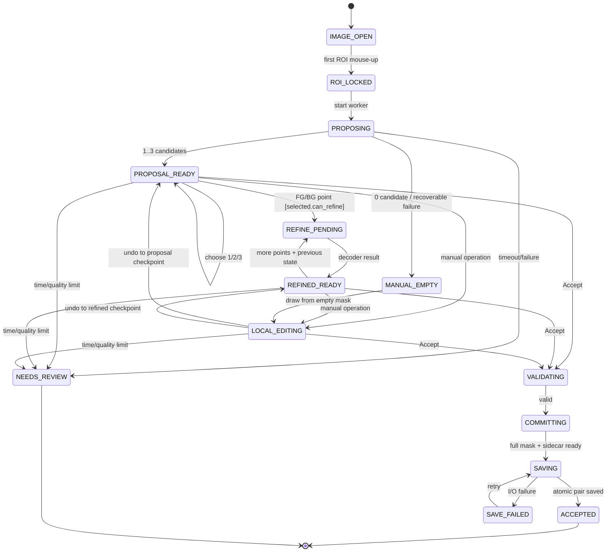

# SegVision 最終開發結論與開工規格（v1）

> 狀態：Implementation-ready / v1 單一開工基準  
> 日期：2026-08-27  
> 產品規格權威：`PRD.md`  
> 工程交付：可被其他 Python 專案 `import` 的 common package + 薄型 Windows GUI  
> 任務：靜態圖、每張一塊二值前景、CPU-only、目標每張決策少於 30 秒

---

## 0. 如何使用這份文件

本文件融合下列內容並完成衝突裁決：

1. `PRD.md` 的已凍結產品決策；
2. `docs/SAM-assisted-annotation-strategy.md` 的長期策略；
3. `docs/FINAL-SegVision-development-recommendation.md` 的 CPU、API、GUI、測試與授權審查；
4. `docs/final-development-recommendation.md` 原有的四週開工草案；
5. Codex、Grok 與三個獨立代理對 CPU 架構、UX、驗證和交付順序的審查。

若文件內容衝突，優先順序為：

```text
PRD 已凍結決策
    > 本文件的 v1 開工規格
    > 長期 strategy / research 建議
```

從現在起，工程師以本文件建立 issue、API 與測試；研究功能仍回到 `SAM-assisted-annotation-strategy.md` 查閱，不得自行塞入 v1 熱路徑。

Claude artifact URL 在目前環境中沒有可用瀏覽器／登入狀態，因此未宣稱已直接讀取；本次以 repository 內的 strategy 文件作替代來源。若 artifact 尚有未同步決策，須另做 delta review，但不阻擋 M1 的純 core 開工。

---

## 1. Final conclusion

v1 只做一條能被量測、能人工保底、能離線交付的 CPU 閉環：

```text
載入原圖
→ 人畫 user ROI
→ 原圖裁出約 10% padding 的工作 crop
→ 固定 class CV recipe（若啟用）先做 direct / coarse / invalid gate
→ 非 direct 時，由單一 CPU 輕量 SAM backend 編碼 crop 一次
→ box prompt 產生最多三張候選
→ 人按 1 / 2 / 3 選擇
→ 正負點 + selected candidate previous mask state 反覆 refine
→ brush / erase / grow / shrink / fill holes 局部修正
→ 人明確選擇 Accept 或 Needs Review
→ Accept 才輸出全圖 binary PNG + versioned JSON sidecar
```

第一個 correctness backend 固定採：

```text
MobileSAM TinyViT + PyTorch CPU
```

它是可先實作的 baseline，不代表未經 benchmark 就是最終 shipping runtime。正式 backend 只能在目標 Windows CPU 完成品質、延遲、記憶體、部署與授權 gate 後凍結，而且 v1 最終只維護一條 production inference 路徑。

v1 的價值不是「AI 全自動找對邊」，而是：

- 多數影像只需一個 ROI、一次候選選擇、零到兩輪 point refine 或少量筆刷；
- 失敗時可快速轉人工，不會卡在模型；
- Accept 的 mask 可直接進訓練資料；
- 不能保證品質時可在時限內標為 Needs Review，不被迫接受壞標註；
- 每個模型、CV recipe 與 GUI 功能都能用 time-to-accept 和 boundary 品質證明價值。

---

## 2. v1 範圍已凍結

| 項目 | v1 決策 |
|---|---|
| 硬體 | 本機 CPU-only；無 CUDA、無遠端推論服務 |
| 影像 | 靜態 RGB 圖 |
| 標註 | 每張一塊 binary foreground / background |
| ROI | `user_roi` + 約 10% padded `crop_rect` |
| 模型 | 一個經 target CPU benchmark 的輕量互動分割 backend |
| 候選 | 0～3 張；不足三張不可複製補滿 |
| Refine | 正負點 + previous mask state；不重跑 encoder |
| Local edit | brush、erase、grow、shrink、fill holes、undo |
| CV | 每類固定、版本化、可關閉、可匯入／匯出的 recipe |
| 融合 | Core 實作純 2-of-3；GUI 預設關；最多三張；禁止全域 OR |
| 輸出 | Accept：全圖 binary PNG + versioned JSON sidecar |
| 失敗 | Needs Review；不得為 KPI 接受錯誤 mask |
| GUI | 本機薄 GUI；所有推論與 mask 邏輯留在 common package |

### 明確不做

- GPU worker、WebSocket inference service；
- SAM 2、SAM 3、HQ-SAM、FocalClick 作 v1 必載模型；
- VLM／文字提示熱路徑；
- Grounding DINO、DINO／TokenCut 自動找點；
- 多 provider 並行搶答；
- 預設融合、像素 OR、自動 Accept；
- 每張影像調 HSV／Lab sliders；
- 多類別 instance UI、影片；
- 自訂模型訓練；
- COCO RLE、polygon、CVAT／Label Studio adapter；
- 同時維護 PyTorch 與 ONNX 兩條正式 deployment 路徑。

---

## 3. 兩個必須修正的舊假設

### 3.1 小 ROI 的主要價值是品質與操作性，不是固定輸入模型的線性加速

MobileSAM 官方建構固定 `image_size=1024`，predictor 會把來源 crop 最長邊 resize 到 encoder 尺寸，再 pad 成方形。因此來源 ROI 從 512 縮到 256，不代表標準 encoder FLOPs 等比例減少。

- [MobileSAM build](https://github.com/ChaoningZhang/MobileSAM/blob/master/mobile_sam/build_sam.py)
- [MobileSAM predictor](https://github.com/ChaoningZhang/MobileSAM/blob/master/mobile_sam/predictor.py)
- [MobileSAM preprocess](https://github.com/ChaoningZhang/MobileSAM/blob/master/mobile_sam/modeling/sam.py)

ROI-first 仍然保留，原因是：

- 目標在模型輸入中佔比較高；
- 隔離遠處干擾物；
- 人更容易判斷候選與邊界；
- crop-level mask 與 local edit 成本較低；
- 為將來真正支援動態輸入的 backend 保留介面。

GUI 在 benchmark 前不得顯示「ROI 縮半，推論會快一倍」。可顯示：

- 目標佔比過低；
- crop 可能截斷物體；
- 目標有效解析度不足；
- 根據實測 latency model 得出的警告。

不可直接把既有 1024 權重改成 512 輸入；這需要重新驗證權重、位置資訊、prompt transform 與輸出 parity。

### 3.2 EdgeSAM 不得直接列入公司 v1

EdgeSAM 官方 license 目前只允許 non-commercial use，商業使用需聯絡作者。[EdgeSAM license](https://github.com/chongzhou96/EdgeSAM/blob/master/LICENSE)

因此：

- 未取得書面許可前，不列入公司 shipping bake-off；
- 可在合法的非商業研究環境獨立評估，但結果不能直接變成產品依賴；
- MobileSAM repository 的 Apache-2.0 授權較適合先做 baseline。[MobileSAM license](https://github.com/ChaoningZhang/MobileSAM/blob/master/LICENSE)

MobileSAM 官方 ONNX export script 主要接收 image embeddings 並匯出 prompt/mask decoder，不能宣稱已有官方完整 TinyViT encoder ONNX deployment。[MobileSAM export script](https://github.com/ChaoningZhang/MobileSAM/blob/master/scripts/export_onnx_model.py)

---

## 4. 每張影像的確切行為

### 4.1 正常路徑

1. GUI 載入原始 RGB image，顯示 class 與該類 recipe 狀態。
2. 人拖出 `user_roi`；mouse-up 產生新 session revision。
3. Core 把 `user_roi` 向外 pad 約 10%，clamp 到影像範圍，得到 `crop_rect`。
4. 若該類固定 CV recipe 啟用，先執行 recipe gate：
   - `direct`：回 `cv_direct` 候選，可跳過 SAM encoder，但仍須人工 Accept；
   - `coarse`：保留 coarse mask，後續轉成 SAM mask prompt；
   - `invalid`：忽略 CV，照一般 SAM 路徑。
5. 非 `direct` 時，backend 對 crop encode 一次。
6. 用 `user_roi` 映到 crop/model 後的 box prompt 取得 SAM 原生最多三張候選。
7. 驗證、去重、排序；CV coarse mask 必須先經 backend mask-prompt decode 成 `sam_cv`，raw coarse mask 不直接成為候選。`sam_cv` 只能替換一個 slot，總數永遠不超過三張。
8. GUI 預設選 rank 1；人可按 `1`、`2`、`3` 切換。
9. 人加正／負點時，以 selected candidate 的 previous mask state + 累積人工點 decode；不 encode。
10. 一旦開始 brush／erase／grow／shrink／fill holes，進入 local editing，模型不得再覆寫結果。
11. 人按 `Space` Accept，或按 Needs Review。
12. Accept 通過驗證後，adapter 原子性寫出全圖 PNG 與 sidecar；成功後才允許 `N` 下一張。

### 4.2 失敗退路

依序處理，不同時啟動多條 AI：

1. 主候選差：切換另外兩張。
2. 局部漏標／溢出：加一個正點或負點。
3. 若連續兩輪 point refine 仍未明顯改善，GUI 建議改用 local edit；這是 UX heuristic，不是 core API 禁止第三輪。每輪都必須帶 previous state，且仍受 30 秒計時約束。
4. crop 截斷物體：一鍵 Expand ROI，建立新 revision 並重跑 recipe/proposal；只有非 `cv_direct` 路徑才 encode。
5. 仍然不理想：進 local edit。
6. backend timeout／exception／空候選：允許從空 mask 手畫，或 Needs Review。
7. 30 秒前仍無法成為 training-quality：Needs Review。

晚到的舊 revision 結果不可顯示為可選候選，也不可覆寫任何人工修改。

---

## 5. ROI 與座標契約

必須分開保存：

- `user_roi_full`：使用者畫的物體 box，也是 SAM box prompt；
- `crop_rect_full`：`user_roi` 向外 pad 後的實際工作 crop。

不可把 padded `crop_rect` 當成 box prompt，否則 padding 中保留的背景 context 會被錯誤宣告成前景範圍。

```text
Full image coordinates
    ├─ user_roi_full: float XYXY
    └─ crop_rect_full: int half-open XYXY
             │ subtract crop origin
             ▼
Crop coordinates
             │ backend-owned resize / normalize / pad
             ▼
Model coordinates
```

不可違反的規則：

- 公開 ROI 與 point 一律用 full-image `(x, y)`；
- rectangle 一律採 half-open `[x0, y0, x1, y1)`；
- image 一律是 `uint8[H,W,3]` RGB；
- `Candidate.mask_roi` 是 crop 原始像素解析度的 boolean mask；
- backend 自己管理 model resize、pad、prompt transform 與 logits postprocess；
- 候選階段不複製 full-image mask；只有 commit 才 uncrop；
- commit 結果必須與原圖 `H×W` 完全相同，crop 外為背景；
- 邊界 warning 檢查 `crop_rect`，不是 `user_roi`；mask 碰 user ROI 通常正常；
- full → crop → model → crop round-trip 誤差須在凍結容許值內，point/box 目標為不超過 1 px。

---

## 6. 候選策略

### 6.1 初始 box 候選

1. `user_roi` 作 box prompt。
2. `multimask_output=True`，取得最多三張 native masks。
3. 移除空 mask、近乎全滿、違反既有人工提示的候選。
4. IoU 極高的重複候選可去重；不足三張顯示實際數量。
5. raw predicted IoU / stability 只能在同一 backend 內排序，不是跨模型真實 confidence。
6. border contact 只加 warning，不可暗中裁掉 mask。

卡片用操作性名稱，例如「推薦」、「較完整」、「較貼邊」；模型名稱與 raw metrics 只放詳細資訊。

### 6.2 安全版 grid prompt

不可把 ROI 中規則網格全部當成前景；ROI 內可能包含洞、背景或其他物體。

若要滿足 PRD 的少量 grid 正點，實作 bounded prompt sweep：

1. 先取得 box-only 原生候選；
2. 求候選 stable intersection；
3. erosion 後取得安全內部區；
4. 只挑 1～2 個落在安全區且彼此分散的點；
5. 用相同 embedding 產生 prompt variant；
6. variant 加入內部 pool 後，再裁成最多三張；
7. stable interior 為空時直接跳過；
8. 第一個人工 point 出現後，移除所有 auto-grid prompts，人的提示優先。

### 6.3 黃色不確定帶

v1 只需要兩層：

```python
UncertaintyLayers(
    disagreement_mask_roi=shown_union & ~shown_intersection,
    crop_edge_risk_mask_roi=crop_edge_contact,
)
```

GUI 可都畫黃色，但 sidecar 必須分辨是候選分歧還是 crop-edge risk。

### 6.4 CV 候選 slot

CV 不可成為第四張卡：

```text
slot 1：最佳有效 sam_box
slot 2：幾何差異最大的 sam_box / sam_safe_grid
slot 3：有效 sam_cv；不存在時才放第三張 SAM 候選
```

`cv_direct` 路徑可只顯示一張，不需要製造兩張假候選。

---

## 7. 固定 CV recipe

CV 是每類固定資料，不是每張圖的調色台。GUI 熱路徑沒有 HSV/Lab sliders。

最小 schema：

```json
{
  "schema_version": 1,
  "recipe_id": "gasket-red-v3",
  "class_id": "gasket",
  "enabled": true,
  "working_long_side": 512,
  "color_space": "LAB",
  "channel_ranges": {
    "l": [20, 220],
    "a": [145, 210],
    "b": [110, 190]
  },
  "preprocess": {
    "median_blur_px": 3
  },
  "postprocess": {
    "open_radius_px": 0,
    "close_radius_px": 0,
    "fill_holes": false,
    "min_component_area": 0
  },
  "quality_gate": {
    "min_area_fraction": 0.01,
    "max_area_fraction": 0.85,
    "max_crop_border_fraction": 0.02,
    "max_components": 4
  },
  "bridge": {
    "policy": "direct_if_clean_else_mask_prompt"
  }
}
```

Recipe 執行結果只有三種：

```python
CvResult(
    binary_mask_roi=...,
    gate="direct" | "coarse" | "invalid",
    diagnostics=...,
)
```

- `invalid`：忽略 CV；
- `coarse`：由 backend 轉成 mask prompt，不抽成正負點，也不把二值圖當 RGB image；
- `direct`：回 `cv_direct` 候選並跳過 encoder，仍需人工 Accept，絕不 auto-accept。

只有某個 class 的固定 recipe 實測能降低時間或操作數，且不降低 boundary 品質，才可預設啟用。

---

## 8. Common package 最終 API

Embedding 與 previous logits 是 session state。GUI 不得自行傳遞可能被混用的 `embedding_id + mask_logits`。

### 8.1 對外使用方式

```python
engine = SegVisionEngine(
    backend=backend,
    cache_policy=cache_policy,
)

with engine.start(
    image_rgb=image,          # uint8 [H, W, 3], RGB
    image_id=image_id,
    roi_full=roi,
    class_id=class_id,
    recipe=recipe,
) as session:
    proposals = session.propose()

    if roi_changed:
        # revision += 1，舊 encoded state / jobs 失效
        proposals = session.update_roi(new_roi_full).propose()

    if proposals.candidates:
        current = session.select(proposals.candidates[0].id)
        if needs_point_refine and current.capabilities.can_refine:
            current = session.refine(
                candidate_id=current.id,
                new_points=[
                    PointPrompt(x=x, y=y, polarity="fg", space="full")
                ],
            )
    else:
        current = session.begin_manual_empty()

    if needs_local_edit:
        current = session.edit_local(
            candidate_id=current.id,
            op=BrushOp(...),
        )

    result = session.commit(
        candidate_id=current.id,
        acceptance=AcceptanceMetadata(...),
    )
```

Undo 也屬於 session contract：

```python
current = session.undo()
# 回到前一個 candidate / model-ready checkpoint；不自動呼叫 backend
```

無法接受時：

```python
review = session.mark_needs_review(
    reason="boundary_unresolved_within_budget"
)
```

`mark_needs_review()` 不產生可進 training set 的 accepted mask。

Core 不接受檔案路徑、不自行存檔、不下載模型、不使用 hidden global cache。

Recipe serialization 是純函式：

```python
recipe_to_json(recipe) -> str
recipe_from_json(payload: str) -> CvRecipe
```

class → recipe mapping 和檔案 I/O 由 caller／adapter 管理。

v1 的 opt-in fusion 只實作一個完整、可測的純函式，不留無作用的公開 stub：

```python
fuse_majority(candidates) -> FusionResult
# foreground = vote_count >= 2
# uncertain  = vote_count == 1
```

GUI 預設不呼叫；禁止用 OR；第一個人工 point 後 fusion 結果立即失效。

### 8.2 Backend protocol

```python
class InteractiveMaskBackend(Protocol):
    @property
    def identity(self) -> ModelIdentity: ...

    @property
    def capabilities(self) -> BackendCapabilities: ...

    def encode(self, crop_rgb: NDArrayUInt8) -> EncodedCrop: ...

    def decode(
        self,
        encoded: EncodedCrop,
        prompts: PromptBundle,
        previous_mask: MaskState | None,
        multimask_count: int,
    ) -> BackendPrediction: ...

    def mask_prompt_from_binary(
        self,
        encoded: EncodedCrop,
        coarse_mask_roi: NDArrayBool,
    ) -> MaskState: ...

    def release(self, encoded: EncodedCrop) -> None: ...
```

GUI 不知道 logits shape、tensor names、normalization、model input size 或 provider-specific score 語意。

### 8.3 主要型別

```python
Candidate(
    id,
    revision,
    mask_roi,
    source,              # sam_box | sam_safe_grid | sam_cv | cv_direct
                         # manual_empty | manual_edit
    generator_identity,  # model | cv_recipe | manual；不強制為模型
    parent_candidate_id,
    capabilities,        # can_refine | can_local_edit | can_commit
    rank_metrics,
    warnings,
    prompts,
)

ProposalSet(
    session_id,
    revision,
    candidates,          # 0..3
    uncertainty,
    crop_context,
    timings,
    warnings,             # proposal-level；0 candidate 時仍可解釋原因
    diagnostics,
)

CommitResult(
    full_image_mask,
    sidecar,             # JSON-serializable；caller/adapter 寫檔
)

ReviewResult(
    sidecar,
    draft_mask_roi=None,
)
```

Previous logits / mask state 留在 session 的 opaque candidate state。

`generator_identity` 是 discriminated union：

```text
ModelGeneratorIdentity(kind="model", backend, model, checkpoint_hash)
CvGeneratorIdentity(kind="cv_recipe", recipe_id, recipe_hash)
ManualGeneratorIdentity(kind="manual")
```

因此 `cv_direct` 和 `manual_empty` 不需要偽造 model identity；`manual_edit` 以 `parent_candidate_id` 保留原候選 provenance。

能力固定為：

| Candidate source | Point refine | Local edit | Accept / Review |
|---|---:|---:|---:|
| `sam_box` / `sam_safe_grid` / `sam_cv` | 是 | 是 | 是 |
| `cv_direct` | 否 | 是 | 是 |
| `manual_empty` / `manual_edit` | 否 | 是 | 空 mask 不可 Accept |

v1 不做 `cv_direct` lazy encode。若使用者需要正負點，必須停用／調整該 class recipe 後建立新 revision，重新走 SAM proposal；GUI 不得暗中在第一次 point click 才載入模型。

### 8.4 不可違反的 invariant

- `cv_direct` proposal 的 encoder call count 必須為 0；其他每個 crop/revision 的 proposal 恰好 encode 1 次；
- safe-grid probes 與 CV coarse → `sam_cv` 只增加 decode，不得額外 encode；
- `update_roi()` 建立新 revision，取消／淘汰舊 jobs，並使舊 candidate handles 失效；
- `begin_manual_empty()` 建立 crop-resolution 全背景的 manual candidate，不呼叫 backend；該空 mask 尚不可 Accept；
- `undo()` 還原前一個 session checkpoint，不由 GUI 私自維護另一份 mask history；
- `refine()` 保留 box、累積人工點與 selected candidate previous state；
- `refine()` 只接受 `can_refine=True` 的 SAM candidate，使用單 mask output，且 encoder call count 不增加；
- 對 `cv_direct` 或 manual candidate 呼叫 `refine()` 必須回 `UnsupportedOperation`，不能 lazy encode；
- ROI 改變後 `revision += 1`，舊 embedding、候選與 edits 失效；
- 換圖即使 ROI 相同也必須重新 encode；
- encoded state 由 session 擁有；cache key 至少綁定 backend/checkpoint fingerprint、preprocess version、crop pixel fingerprint 與 `crop_rect`；
- cache 只放 RAM、容量有界且可明確 release，不落磁碟；
- 候選永遠為 0～3 張；
- 第一個人工 point 後丟棄 fusion 與 auto-grid prompts；
- 第一個 local edit 後不得再呼叫模型，除非 undo 回 model state；
- `commit()` 輸出與原圖同尺寸，crop 外為背景；
- only explicit Accept can produce a training annotation；
- `cv_direct` 必須可證明沒有呼叫 encoder；
- core input 不可被原地修改。

### 8.5 Warning 與 typed error

Warnings：

```text
EMPTY_MASK
TOUCHES_WORK_CROP_EDGE
LOW_PROVIDER_SCORE
TINY_COMPONENTS
TARGET_OCCUPANCY_LOW
INVALID_RECIPE
```

Typed errors：

```text
InvalidRoi
RecipeSchemaError
RecipeClassMismatch
EmbeddingExpired
StaleRevision
BackendUnavailable
UnsupportedOperation
```

低分、空 mask、貼 crop 邊通常是可處理 warning，不應全部變 exception。

---

## 9. 專案結構與依賴方向

Repository 目前是 greenfield；第一個實作提交建立：

```text
pyproject.toml
src/segvision/
  core/
    api.py                 # SegVisionEngine / AnnotationSession
    types.py               # typed data contracts
    geometry.py            # full/crop/model coordinate contract
    candidate_policy.py    # validate / dedupe / rank / cap=3
    mask_ops.py            # brush/grow/shrink/fill/commit/fuse
    recipe.py              # versioned recipe schema + serialization
  runtime/
    embedding_cache.py     # bounded in-memory cache
    jobs.py                # worker/cancel/revision gate
  providers/
    base.py                # InteractiveMaskBackend protocol
    fake.py                # tests / headless vertical slice
    mobile_sam_torch_cpu.py
  cv/
    fixed_recipe.py
  adapters/
    png_sidecar.py         # 唯一負責 annotation file I/O
  gui/
    controller.py
    canvas.py
    panels.py
benchmarks/
  target_cpu.py
tests/
  unit/
  integration/
  fixtures/
```

依賴只能朝這個方向：

```text
GUI / adapters → core engine → backend protocol
                         ↘ CV pure functions
```

- provider、core、storage 不可引用 GUI；
- core 不碰 filesystem；
- adapter 不做 candidate decision；
- GUI controller 不直接操作 model tensor；
- inference 放單一 background process；
- PyTorch／ORT／OpenCV／BLAS thread 數必須可設定，避免 CPU oversubscription。

---

## 10. Session 與 GUI 狀態機



狀態機補充規則：

- 任一 active state 的 ROI 重畫／Expand ROI 都會 `revision += 1` 並重新進入 `ROI_LOCKED → PROPOSING`；第一次 ROI lock 的計時不重設；
- decoder 執行中收到新 point 或 ROI change 時，舊 job 必須 cancel 或在完成後因 revision 不符被丟棄；
- local edit 的 undo 只回復到最後一個 model-ready checkpoint，不會自動呼叫 decoder；
- validation 失敗回到原本可編輯狀態，並顯示可處理原因；
- save failed 保留完整 session，必須允許 retry，不能先標成 Accepted；
- 任何尚未 Accepted 的 annotation state 都可由人明確轉成 Needs Review；
- `Needs Review` 不可進 training set，也不可被報表算成成功 Accept。

---

## 11. 薄 GUI

第一版建議 PySide6 desktop，因為可直接包 Python CPU inference，不需 web server。GUI framework 不得阻塞 headless core；先做 canvas spike，只有 overlay／brush p95 無法達標時才替換 rendering 層。

```text
┌────────────────┬───────────────────────────────┬──────────────────┐
│ Class / Recipe │ 原圖 Canvas                   │ Candidate 1/2/3  │
│ id / version   │ user ROI + crop context       │ thumbnail        │
│ enabled / off  │ selected mask + yellow band   │ source / warning │
│ import/export  │ cursor loupe                   │ model rank       │
├────────────────┴───────────────────────────────┴──────────────────┤
│ ROI | FG | BG | Brush | Erase | ±1 | Fill | Timer | Needs Review│
└──────────────────────────────────────────────────────────────────┘
```

必要快捷鍵：

- `1` / `2` / `3`：選候選；
- 左／右鍵：正點／負點；
- `B`：brush；
- `[` / `]`：shrink / grow；
- `F`：fill holes；
- `X`：Expand ROI；
- `Z`：undo；
- `Space`：Accept；
- `N`：成功存檔後下一張。

v1 畫面不顯示文字輸入、DINO points、HSV sliders、多 provider loading、instance tabs 或預設 fusion。

選到 `cv_direct` 或 manual candidate 時，FG/BG point 工具必須 disabled 並顯示原因；brush／erase 等 local edit 仍可使用。

---

## 12. 30 秒定義、資料品質與失敗計算

正式記兩個不同指標：

```text
annotation_time  = accept_validation_passed - first_roi_locked
decision_time    = (accept_validation_passed or needs_review_clicked) - first_roi_locked
within_30_accept = status == accepted and annotation_time < 30_000 ms
```

- 產品主目標：每張 accepted image 的 `annotation_time < 30 s`；
- 安全目標：30 秒內至少做出 Accept 或 Needs Review 決定；
- ROI 重畫、Expand ROI、切候選或切換 refine/local edit 都不得重設 `first_roi_locked`；
- Needs Review 不算 Accept 成功；
- 每次按 `Space` 先記 `accept_attempted`；只有 validation 通過才記 `accept_validation_passed` 並停止 annotation timer；
- validation 失敗會回到編輯狀態，先前無效的 Accept attempt 不得縮短時間；
- 超過 30 秒的 Accept 仍可保留正確標註，但算 time SLO failure；
- 不可只報 p50，至少報 p50 / p90 / p95、`<30s` pass rate、Needs Review rate、timeout rate 與錯誤接受率。

### Accept hard validation

Commit 前驗證 crop candidate：

- `mask_roi` 非空、binary，尺寸等於 `crop_rect`；
- 所有人工正點在 mask 內、負點在 mask 外；
- candidate revision 等於 session 最新 revision；
- crop-edge warning 已 Expand ROI 或留下明確確認。

Core commit 後、saving 前驗證 full result：

- full mask 為 binary，尺寸與原圖完全相同；
- crop 外像素全為背景；
- sidecar status / candidate / revision 與 committed result 相符。

PNG 與 sidecar 成對發布成功後才進入 `ACCEPTED`，也只有此時才可下一張。

### 品質指標

不能只看 IoU。M0 要在原圖座標凍結至少一個 boundary metric：

- boundary F-score；或
- normalized mean boundary distance；或
- 固定寬度 trimap error。

同時保留工程師主觀 Accept＝可餵訓練。客觀 boundary 與主觀 Accept 必須同時通過。

---

## 13. Sidecar 與輸出

Accepted annotation 的最小 sidecar：

```json
{
  "schema_version": 1,
  "image_id": "...",
  "image_shape": [1080, 1920],
  "class_id": "gasket",
  "status": "accepted",
  "training_eligible": true,
  "mask_file": "image-id.mask.png",
  "mask_sha256": "...",
  "user_roi_full": [100, 120, 500, 520],
  "crop_rect_full": [60, 80, 540, 560],
  "padding_fraction": 0.1,
  "selected_candidate": {
    "id": "...",
    "rank": 1,
    "source": "sam_box",
    "warnings": []
  },
  "generator": {
    "kind": "model",
    "name": "mobile_sam_torch_cpu",
    "model_version": "...",
    "checkpoint_sha256": "...",
    "runtime_version": "..."
  },
  "recipe": {
    "recipe_id": null,
    "recipe_hash": null
  },
  "prompts_full": [],
  "operations": [],
  "timings_ms": {},
  "hardware": {},
  "accepted_warnings": []
}
```

`cv_direct` 的 generator `kind` 為 `cv_recipe`；完全從空白手畫時為 `manual`。若人工編輯源自模型候選，sidecar 同時保存 parent candidate provenance 與 operations。

至少記錄以下事件：

```text
image_visible
roi_drag_started
first_roi_locked / roi_relocked
encode_started / encode_finished
first_candidate_ready / all_candidates_ready
candidate_selected
refine_started / refine_finished
first_local_edit
accept_attempted / accept_validation_passed / needs_review_clicked
commit_started / commit_finished
next_image
```

Accepted PNG 與 sidecar 由 adapter 以 pair-consistent transaction 寫出：

1. PNG 與 sidecar 都先寫同目錄的唯一 temp name；
2. flush、關檔並驗證 PNG 尺寸／hash 與 sidecar schema；
3. 用 atomic replace 發布 PNG；
4. 最後用 atomic replace 發布 sidecar，sidecar 是「此 annotation 完整」的 commit marker；
5. loader 只接受 sidecar 存在、status accepted、mask filename/hash 相符的 pair；
6. 任一步失敗都保留 session、停用 `N`、清理或隔離 temp，讓人 retry。

這不是宣稱兩個 filesystem rename 能同時發生，而是確保 reader 永遠不把半套檔案視為 accepted annotation。

Needs Review 只寫 review metadata，或把 draft 存到明確隔離的 review namespace，絕不可混入 training annotation 目錄；其 sidecar 必須包含：

```json
{
  "status": "needs_review",
  "training_eligible": false
}
```

---

## 14. 可以立即建立的工程 backlog

### 14.1 Issue 順序

| ID | 工作 | 依賴 | 完成證據 |
|---|---|---|---|
| SV-000 | 凍結標註規則、目標 CPU、資料集 manifest | 無；與 M1 並行 | 決策表 + 可重跑 baseline |
| SV-001 | 建立 Python package、test/lint 基礎 | 無 | clean env 可 import、tests 可執行 |
| SV-002 | 定義 types、errors、backend protocol | SV-001 | public contract tests |
| SV-003 | 實作 ROI/crop geometry 與 commit | SV-002 | round-trip / border tests |
| SV-004 | Fake backend + session/revision/cache | SV-002/003 | 無模型完整跑 propose→commit |
| SV-005 | candidate validate/dedupe/rank/cap/uncertainty + 2-of-3 fuse | SV-004 | deterministic fixtures，永遠 ≤3，fusion 不是 OR |
| SV-006 | target CPU benchmark harness | SV-001/002 | cold/warm/encoder/decoder/RAM report |
| SV-007 | MobileSAM PyTorch CPU backend | SV-003/006 | headless encode-once vertical slice |
| SV-008 | previous-state refine + point history | SV-007 | refine encoder count = 0 |
| SV-009 | local mask ops + undo + model-call lock | SV-004 | edit 後不做 model merge；只有 undo 回 checkpoint 才可 refine |
| SV-010 | background worker/cancel/stale gate | SV-004/007 | old revision result discarded |
| SV-011 | thin GUI canvas/candidate cards/hotkeys | SV-004/010 | 人可走完一張圖 |
| SV-012 | PNG/sidecar adapter + atomic save | SV-003/011 | save/reload round-trip |
| SV-013 | fixed CV recipe + direct/coarse/invalid | SV-002/007 | recipe tests + per-class gate |
| SV-014 | telemetry/user study/quality report | SV-011/012 | time + boundary + Accept report |
| SV-015 | offline packaging/license manifest | SV-007/012 | clean Windows install/launch |

### 14.2 第一個 PR：現在就可以做

第一個 PR 不下載模型，也不選 GUI framework。內容固定為：

```text
PR-01 Core contract and geometry
  ├─ pyproject.toml
  ├─ src/segvision/core/types.py
  ├─ src/segvision/core/geometry.py
  ├─ src/segvision/providers/base.py
  ├─ src/segvision/providers/fake.py
  ├─ tests/unit/test_geometry.py
  └─ tests/unit/test_contracts.py
```

PR-01 Definition of Done：

- package 可在 clean virtual environment `import segvision`；
- `ImageSize`、`RoiFull`、`CropContext`、`PointPrompt`、`GeneratorIdentity`、`Candidate`、`ProposalSet`、`CommitResult`、`ReviewResult` 型別完成；
- `user_roi` 與 `crop_rect` 絕不混用；
- pad / clamp 正確處理四邊、1 px、奇偶尺寸與超界；
- full ↔ crop point/box round-trip 測試通過；
- fake backend 可以記錄 encode/decode call count；
- 沒有 GUI、模型權重、filesystem side effect 或 hidden global singleton；
- 所有 public coordinate space 和 dtype 寫入 docstring。

### 14.3 接下來三個 PR

```text
PR-02 Session vertical slice
  start → propose → select → refine → edit_local → commit
  revision、stale-result、encode-once、previous-state tests

PR-03 Benchmark harness + MobileSAM correctness backend
  target hardware manifest、cold/warm timings、peak RAM
  box multimask、opaque previous state、fixed fixtures

PR-04 Thin GUI vertical slice
  ROI、候選 1/2/3、point refine、brush、Accept/Needs Review
  background worker、atomic PNG/sidecar save
```

PR-01 與 M0 資料／標註規則可平行進行；不需要等模型選型或 GUI 會議。

---

## 15. 里程碑與 Exit Gate

里程碑是依賴順序，不是未經團隊估算的日曆承諾。

### M0：規格、資料與目標硬體

交付：

- `docs/annotation-policy.md`：洞、陰影、反光、透明、遮擋、斷開區域、原圖截斷的標註規則；
- `docs/adr/0001-acceptance-and-metrics.md`：30 秒、Accept、Needs Review、boundary 門檻；
- `docs/adr/0002-target-hardware.md`：目標 Windows CPU、RAM、runtime、thread policy；
- `benchmarks/dataset-manifest.jsonl`：100～300 張代表性全新場景與分層 gold subset；
- `models/manifest.json`：初始 backend、checkpoint、checksum 與授權狀態；
- 既有單點 SAM 的 time / boundary baseline；
- boundary metric、trimap 寬度、Accept 與 Needs Review 門檻；
- ROI 尺寸對固定 1024 backend latency 的實測。

Exit：規則與基線可重跑，不再用 ROI 面積猜 encoder 時間。

### M1：Core contract + fake backend

交付：types、geometry、mask ops、recipe schema、session、fake backend、unit tests。

Exit：不下載模型、不啟動 GUI，也能完整測試 propose / refine / local edit / commit / needs review。

### M2：MobileSAM CPU headless vertical slice

交付：

- MobileSAM PyTorch CPU correctness backend；
- user ROI / crop context；
- encode once、native multimask、previous-state refine；
- candidate cap、去重、黃色帶與 warning；
- target CPU benchmark。

Exit：SAM proposal 路徑的同一 ROI/revision encoder call count 恰好為 1；每輪 refine 增加 0 次 encoder call；失敗能誠實回 warning/error。M4 另證明 `cv_direct` 為 0 次。

### M3：薄 GUI + manual fallback

交付：

- ROI、候選卡、黃色帶、正負點、undo；
- brush、erase、grow、shrink、fill holes；
- background process、cancel、revision gate；
- Accept / Needs Review；
- PNG + sidecar adapter。

Exit：從 clean image 到可重新載入 accepted annotation 的完整 vertical slice；backend 失敗時仍可人工完成或送 review。

### M4：固定 CV recipe

交付：schema validation、import/export、invalid/coarse/direct gates、mask prompt、`cv_direct`。

Exit：沒有 per-image threshold UI；每類 recipe 只有在降低時間／動作且不降低 boundary 品質時才預設開啟。

### M5：驗證、封裝與 beta

交付：

- 固定目標硬體 benchmark；
- 工程師真實標註研究；
- clean Windows CPU-only offline install / launch；
- dependency lockfile、SBOM、`THIRD_PARTY_NOTICES`、model manifest。

Exit：時間、主觀 Accept、客觀 boundary、安裝與授權全部通過。

---

## 16. 測試與驗收矩陣

### Unit

- ROI pad/clamp、四邊、1 px、奇偶尺寸、half-open 座標；
- full ↔ crop ↔ model point/box/mask round-trip；
- RGB/BGR、dtype、binary mask contract；
- commit 尺寸、位置與 crop 外背景；
- candidate cap、去重、deterministic rank；
- model / cv_recipe / manual generator identity 與 parent provenance；
- candidate capability matrix；`cv_direct` / manual refine 回 `UnsupportedOperation` 且不 lazy encode；
- 0 candidate 時的 proposal-level warning / diagnostics；
- 黃帶與 crop-edge warning；
- refine 攜帶 previous state 且不 encode；
- `begin_manual_empty()` 不呼叫 backend，空 mask 不可 Accept；
- `undo()` 精確還原 session checkpoint 且不自動 decode；
- local edit 不呼叫 backend，且 input immutable；
- opt-in fusion 若實作，必須驗證 `vote >= 2` 且明確證明不是 OR；
- recipe JSON round-trip、未知版本、class mismatch；
- `direct` 跳過 encoder；`coarse` 使用 mask prompt；
- cache eviction、revision、stale-result rejection；
- PNG/sidecar schema round-trip。

### Integration

- fake backend 完整 headless workflow；
- MobileSAM CPU 固定 fixtures regression；
- box prompt + 最多三候選；
- safe-grid stable interior 為空時不加點；
- 多輪人工點 refine 保留點歷史；
- CV off 絕不呼叫 CV；CV on 的三種 gate 正確；
- 第一個人工點清除 auto prompts / fusion；
- local edit 後晚到模型結果不能覆寫；
- empty、timeout、exception → manual fallback / Needs Review；
- GUI `1/2/3`、undo、Accept、Needs Review、下一張；
- GUI 對不可 refine candidate 停用 FG/BG point 工具；
- crop candidate pre-commit 與 full mask post-commit 的分段 validation；
- first ROI lock 計時，ROI 重畫不重設；
- 無效 `accept_attempted` 不停止 timer；只用 `accept_validation_passed` 計算 `<30s`；
- Accept validation、save failure retry 與存檔前禁用下一張；
- save 後 full mask 與 sidecar 可重載。

### Performance

固定目標 Windows 機器量：

- cold model load；
- warm encoder p50 / p90 / p95；
- initial decoder 與 cached refine p50 / p95；
- peak RAM、cache eviction；
- overlay / brush input-to-frame p95 `<100 ms`；
- cached refine best-effort p95 `≤1 s`；
- accepted time、decision time、`<30s` pass rate；
- Needs Review、timeout、錯誤接受率；
- 不同來源 ROI 尺寸下的 encoder latency與 target occupancy。

Wall-clock gate 不放在不固定硬體的共享 CI；CI 驗功能，target machine benchmark 驗 SLO。

### Quality / user study

至少比較：

1. 單點 SAM baseline；
2. ROI + box 三候選；
3. + previous-state point refine；
4. + local edits；
5. + 固定 class CV recipe。

記錄 time、clicks、strokes、候選 rank、ROI 重畫、recipe 使用、boundary metric、Accept、Needs Review 與錯誤接受。

保留某功能的條件只有一個：降低時間或人工動作，且不降低 boundary 品質。

---

## 17. 需求追溯

| PRD 要求 | 實作位置 | 驗收證據 |
|---|---|---|
| CPU-only | `providers/` + packaging | clean machine 無 CUDA 啟動 |
| 一張圖一塊前景 | `Candidate` / `commit` | binary full-mask tests |
| 小 ROI / crop | `geometry.py` | coordinate / clamp tests |
| encode once | session + backend counter | SAM propose=1、`cv_direct`=0、refine=0 encode |
| 最多三候選 | `candidate_policy.py` | cap / dedupe tests |
| opt-in 2-of-3 fusion | `mask_ops.py` | `vote >= 2`、yellow uncertainty、not-OR tests |
| previous logits refine | opaque `MaskState` + capability guard | SAM multi-round test；CV/manual refine rejected |
| 固定 class CV | `recipe.py` / `fixed_recipe.py` | schema / gate / round-trip tests |
| local edit 不跑 SAM | `mask_ops.py` | backend call count unchanged |
| 人 Accept | GUI state + session commit | no auto-accept test |
| Needs Review | session / adapter | excluded from training output test |
| 全圖 PNG + sidecar | `png_sidecar.py` | atomic save/reload test |
| `<30 s` | telemetry | target-machine user-study report |
| boundary 品質 | evaluation harness | frozen metric comparison |

---

## 18. 授權、模型與封裝

- model code、checkpoint、model card、轉換後 artifact 分開記錄 license；
- 建立 `models/manifest.json`：來源、版本、SHA-256、license、散布方式；
- 不把大型權重直接提交 Git；
- 官方下載後驗 checksum；避免不受信任 pickle；
- MobileSAM baseline 仍要分別審查 code 與 checkpoint；
- EdgeSAM 未取得商用許可前不得進公司 v1；
- X-AnyLabeling 的 GPL 程式與資產只可參考 UX，不複製進閉源產品；
- PySide6 的 LGPL／商業散布義務列入 notices；
- ONNX Runtime 的授權不替 model weights 背書；
- 鎖 Python、NumPy、OpenCV、Torch／ORT 版本；
- 避免同時安裝不同 OpenCV binary packages；
- clean-machine 測試不得需要 CUDA、登入或網路服務。

---

## 19. 開工時仍需由人凍結的決策

這些不阻擋 PR-01 / PR-02，但會阻擋對外宣稱 M2/M5 完成：

| 決策 | Owner | 最晚時間 |
|---|---|---|
| 目標 Windows CPU、最低 RAM | 技術負責人 | M0 Exit 前 |
| 洞、陰影、透明、反光、遮擋、斷開區域規則 | 標註負責人 | gold subset 前 |
| boundary metric、trimap 寬度與門檻 | ML / QA | M0 Exit 前 |
| `<30 秒` 的 beta pass-rate 門檻 | 產品負責人 | M3 user study 前 |
| 最低 Accept rate、最高 Needs Review rate | 產品 / ML | M3 user study 前 |
| Claude artifact 是否有額外決策 | 文件 owner | M2 model freeze 前 |

---

## 20. v1 Definition of Done

以下全部成立才算完成：

- common package 可由其他 Python 工程直接 `import`；
- core 不讀寫檔案、不下載模型、不依賴 GUI；
- CPU-only clean Windows 可離線安裝與啟動；
- 非 `cv_direct` 的同一 ROI/revision encode 一次；`cv_direct` 為零次；refine 不重算 encoder；
- GUI 永遠顯示不超過三個候選；
- SAM candidate 的第一個人工點使用 selected candidate previous state；CV/manual candidate 不提供 point refine；
- local edit 後模型不能覆寫結果；
- Accept 與 Needs Review 明確分離；
- Accepted PNG 與 sidecar 可成對重新載入；
- overlay / brush p95 `<100 ms`；
- time、boundary、Accept 三類指標全部記錄並通過 M0 凍結門檻；
- runtime、model、checkpoint、GUI dependencies 有完整授權清單；
- 文字、DINO、SAM 3、HQ-SAM、多 provider 與預設融合沒有進入 v1 熱路徑。

---

## 21. Later 的進入條件

v1 累積真實 failure cohort 後，才依序評估：

1. HQ-SAM / focus crop：處理已知邊界失敗；
2. DINO / TokenCut：處理已知漏 component；
3. 文字 / Grounding DINO / SAM 3：處理語意定位失敗；
4. 多 provider／校準式進階融合：只處理基本 2-of-3 無法改善的 cohort；
5. 少數類別：另訂不重畫 ROI、不重編碼的 session 契約；
6. COCO RLE / polygon / 外部標註平台 adapters。

每項 Later 功能都必須：

- 對準已知 failure cohort；
- 降低 time-to-accept 或人工動作；
- 不降低 boundary 品質；
- 通過依賴與模型授權檢查；
- 預設關閉並可獨立移除。

---

## 22. 工程團隊的最後一句話

現在不要先做多模型，也不要先做完整 GUI。直接從 **PR-01：types + geometry + fake backend tests** 開始；同時完成 M0 的目標 CPU、標註規則與 gold baseline。接著做 MobileSAM CPU headless vertical slice，證明 SAM path encode once / refine without encode，再接薄 GUI、人工保底、輸出與固定 CV recipe。

這是目前最小、最可驗證，也最能實際達成「新場景、靜態圖、一塊前景、30 秒內完成決策」的開發路徑。
