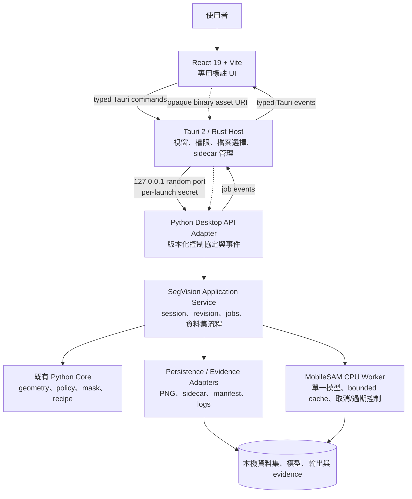

# SegVision React + Tauri 桌面架構建議

> 狀態：架構建議，不是已核准的實作規格  
> 日期：2026-08-29  
> 適用範圍：SegVision v1 的 Windows 離線 CPU 桌面應用程式

## 1. 結論

對 SegVision 而言，最合適的方向是：

**React + Vite 負責操作介面，Tauri 2 負責原生視窗、安全邊界與 Python 行程生命週期，既有 Python SegVision 則作為唯一的領域與推論引擎。**

這不是把現有 Python 程式全部改寫成 Rust 或 TypeScript，也不應把 SegVision 做成通用入口網站、iframe 容器或插件平台。它應該是一個專用的影像標註 Native App：

- React 只管理顯示與互動，不擁有模型狀態或最終 mask。
- Tauri 只管理桌面能力與安全橋接，不實作 segmentation 規則。
- Python sidecar 保留現有 `core`、MobileSAM provider、工作排程、持久化與驗收證據。
- 大型影像與 mask 走二進位資料通道，不塞入 Tauri command 的 JSON。
- 所有操作帶 `session_id`、`revision` 與 `request_id`，過期推論結果不得覆蓋新狀態。

這個架構能得到 React 的 UI 開發效率與 Tauri 的桌面體驗，同時保留目前已驗證過的 Python 演算法與 OpenSpec 契約。

## 2. 為什麼不是直接延用 PySide6

PySide6 對純 Python 工具很直接，但 SegVision 的主要介面包含資料集瀏覽、縮放平移、ROI、正負點、候選比較、筆刷修補、長任務進度、可恢復錯誤與結果檢視。這些需求更適合以 React 的元件、狀態管理與前端測試生態實作。

Tauri 相較 Electron 的主要優點是安裝包與記憶體負擔較小，且能把檔案系統、sidecar 與作業系統能力限制在 Rust host；代價是跨行程協定、Python 打包與 WebView 相容性需要被正式設計及測試。

| 選項 | 優點 | 主要代價 | SegVision 建議 |
| --- | --- | --- | --- |
| PySide6 | Python 整合最直接 | 複雜互動 UI、前端測試與設計系統成本較高 | 保留到新 GUI 達到功能同等，不作長期預設 |
| Electron + React | 生態成熟、Chromium 一致 | 包體、記憶體與更新面積較大 | 可行，但不是 CPU/offline 工具的首選 |
| Tauri 2 + React | 輕量、原生能力可收斂、安全邊界清楚 | sidecar、WebView2、協定與封裝較複雜 | **建議方案** |

## 3. 必須遵守的既有邊界

React/Tauri 是 GUI 與部署架構的替換，不應改變 SegVision 的產品語意：

- 僅 CPU、離線執行，不在 runtime 下載模型或呼叫遠端服務。
- 核心維持 headless、in-memory，不引入 GUI 或檔案 I/O。
- MobileSAM checkpoint 必須先通過授權與 checksum 驗證，再反序列化。
- 同時最多三個真實候選，不製造填充候選。
- ROI、正負點、局部編輯、Accept 與 Needs Review 的既有規則不變。
- 模型結果不得覆寫使用者已做的局部編輯。
- 不自動 Accept；人類操作與 release signoff 不得由測試或程式捏造。
- 影像座標維持 full-image 座標與既有 half-open `XYXY` 契約。
- MVTec 資料集及其授權內容不可因桌面封裝而被重新散布。

目前 active OpenSpec 將 PySide6 凍結為 v1 GUI 預設。正式切換 React/Tauri 是公開架構變更，應先建立新的 OpenSpec change，定義傳輸協定、功能同等、封裝與退場條件；不能只修改現有程式後宣稱已取代。

## 4. 建議的整體架構



核心原則是 **單向依賴**：

```text
React UI → Tauri Host → Desktop Transport → Application Service → Core / Providers / Adapters
```

下層不得反向依賴 React、Tauri 或瀏覽器物件。

## 5. 各層責任

### 5.1 React UI

React 擁有：

- 畫面配置、工具列、資料集清單、候選卡片與狀態提示。
- viewport 的 zoom、pan、hover、目前工具與未提交筆畫。
- Canvas 上的即時預覽，以及對 authoritative state 的投影。
- 呼叫 typed client、接收事件、顯示 retry/recovery 狀態。

React 不擁有：

- MobileSAM embedding、logits、模型物件或 checkpoint 路徑。
- authoritative mask、候選 provenance、Accept 結果或持久化真相。
- 任務完成與否的自行推定。
- 任意檔案系統路徑或 shell 執行能力。

不建議把每個像素、筆刷點或大型 mask 放進 React 全域 store。全域 store 只保存小型、可序列化的 UI/view model；影像與 mask 由瀏覽器解碼後交給 Canvas，生命週期由 asset cache 管理。

### 5.2 Tauri Host

Tauri 是最小權限的桌面 host：

- 啟動、健康檢查、監看、重啟及關閉 Python sidecar。
- 找一個隨機 localhost port，產生每次啟動專用 secret。
- 提供檔案/資料夾選擇器，將使用者授權的選擇轉成 capability/grant。
- 代理小型 JSON control requests 與 sidecar events。
- 透過受限 custom protocol 供應影像與 mask binary asset。
- 收集 host/sidecar log，提供明確的診斷與匯出入口。
- 在正式版限制 command allowlist、CSP、devtools 與外部導航。

Tauri 不應：

- 重寫候選排序、ROI、mask 合併或 Accept 規則。
- 解析模型 tensor 或進行 segmentation。
- 暴露任意 `read_file`、`write_file` 或 `run_command` 給 React。
- 把 sidecar port 與 secret 暴露成一般前端設定。

### 5.3 Python Desktop API Adapter

這一層是 transport adapter，不是第二套核心：

- 驗證 protocol version、schema、session、revision 與 request id。
- 將 transport DTO 轉為現有 core/application 型別。
- 把例外轉成穩定的 error code，不把 Python stack trace 當 UI 協定。
- 發送 job progress、completed、cancelled、stale、failed 等事件。
- 簽發短生命週期、不可猜測的 binary asset token。

可使用 FastAPI/Starlette 類 ASGI 實作；選擇理由應是清楚的 schema 與測試能力，而不是讓 React 直接把它當遠端網站。正式版 sidecar 僅綁定 `127.0.0.1`，不對區域網路開放。

### 5.4 SegVision Application Service

建議新增薄的 application layer，協調既有模組但不複製其規則：

- 開啟資料集、分頁與目前影像工作流程。
- 建立/關閉 annotation session。
- 管理 `revision`、candidate selection、refinement 與 edit commit。
- 送出、取消與觀察 runtime job。
- 協調持久化、evidence 與可恢復 draft。

現有 `src/segvision/core`、`providers`、`runtime`、`adapters` 和 `acceptance` 應繼續作為權威實作。

## 6. 狀態的唯一擁有者

| 狀態 | 唯一擁有者 | UI 可以做什麼 |
| --- | --- | --- |
| zoom、pan、hover、panel 開關 | React | 直接更新 |
| 未提交 ROI/點/筆刷預覽 | React | 本機預覽，提交後等待新 revision |
| session、revision、selected candidate | Python application service | 顯示 server snapshot，不自行改寫歷史 |
| mask、候選、provenance、local-edit flag | Python core/session | 透過 asset 與摘要顯示 |
| inference job 與取消狀態 | Python runtime | 發出命令並訂閱事件 |
| sidecar PID、port、secret、health | Tauri | 僅顯示健康摘要 |
| output、sidecar、evidence | Python adapters | 顯示已確認的儲存結果 |
| 使用者選定的檔案/資料夾 grant | Tauri | 保存 opaque grant id，不任意組合路徑 |

這個分工可以避免最常見的桌面前端錯誤：React、Rust 與 Python 各保存一份「目前 mask」，最後三份狀態互相衝突。

## 7. IPC 與資料傳輸

### 7.1 Control plane

小型控制資料建議走：

```text
React typed client
  → Tauri invoke command
  → Rust HTTP client
  → Python localhost API
```

每個 mutation request 至少包含：

```json
{
  "protocol_version": "1.0",
  "request_id": "uuid",
  "session_id": "uuid",
  "base_revision": 12,
  "operation": "refine"
}
```

成功回應必須回傳新的 authoritative `revision`。若 `base_revision` 已落後，sidecar 回傳明確的 `revision_conflict`，React 重新取得 snapshot；不可靜默覆蓋。

推薦的概念性 API：

| 操作 | 目的 |
| --- | --- |
| `GET /v1/health` | 啟動、版本、模型與能力檢查 |
| `POST /v1/datasets/open` | 使用 Tauri grant 開啟資料集 |
| `GET /v1/datasets/{id}/items` | cursor-based 分頁與摘要 |
| `POST /v1/sessions` | 為影像建立 annotation session |
| `GET /v1/sessions/{id}` | 取得 authoritative snapshot |
| `POST /v1/sessions/{id}/proposals` | ROI 產生候選 |
| `POST /v1/sessions/{id}/refinements` | 正負點 refinement |
| `POST /v1/sessions/{id}/edits` | 提交局部編輯 delta |
| `POST /v1/sessions/{id}/accept` | 明確的人類 Accept |
| `POST /v1/sessions/{id}/needs-review` | 保存待複核狀態 |
| `POST /v1/jobs/{id}/cancel` | 取消尚未完成的工作 |
| `GET /v1/assets/{token}` | 取得短效 binary asset |

這是 transport 形狀建議，不得藉此改變現有 core method 的行為。

### 7.2 Event plane

Python 將背景工作事件送到 Tauri，再由 Tauri 發出 typed event 給 React。事件至少帶：

- `event_id`
- `request_id`
- `job_id`
- `session_id`
- `revision`
- `kind`
- `timestamp`
- 可顯示的 progress/error payload

React 收到比目前 revision 舊的 `completed` 事件時只能丟棄，不能把它畫回 Canvas。Python runtime 也應先做一次 stale rejection；前後兩層防護是必要的競態保險。

### 7.3 Data plane

大型資料不要走 JSON、base64 或數萬個整數陣列。

| 資料 | 建議格式 | 傳輸方式 |
| --- | --- | --- |
| 原圖/縮圖 | PNG、JPEG 或 WebP，依來源與無損需求決定 | opaque asset URI |
| 二值 mask | PNG `{0,255}`；需要時再評估 RLE/bit-pack | opaque asset URI |
| overlay | 前端以原圖 + mask 合成 | 不傳預合成全圖 |
| ROI、點、候選摘要 | 小型 JSON | control plane |
| 筆刷編輯 | stroke/delta，小批次提交 | control plane |
| embedding/logits | 不離開 Python process | 不傳輸 |

推薦讓 React 使用例如 `segvision-asset://<opaque-token>` 的受限 URI，由 Rust 驗證 token 後串流 sidecar binary response。token 必須綁定 session、revision、asset kind 與到期時間，且不能接受 `..` 或任意本機路徑。

初版不需要 shared memory。只有在真實 1024+ 影像的 trace 證明 binary proxy 是瓶頸時，才考慮 memory-mapped file 或 shared-memory transport；不要先增加跨平台清理與安全複雜度。

## 8. Canvas 與標註互動

建議使用 React DOM 做控制元件，`Canvas2D` 做像素級畫面：

- 底層：原圖。
- overlay：authoritative mask，以固定 alpha/顏色呈現。
- interaction：ROI、正負點、筆刷游標、未提交 stroke。
- selection：目前候選與 provenance 提示。

初版優先 Canvas2D；只有量測證明大圖渲染無法達標時才升級 WebGL。不要因為使用 React 就把每個點或像素做成 DOM element。

座標轉換必須集中成單一模組並具備測試：

```text
screen/CSS pixel
  ↔ device pixel ratio
  ↔ viewport transform (zoom/pan)
  ↔ full-image integer coordinate
```

ROI 顯示與送出的值皆遵守既有 half-open `XYXY`。pointer move 只更新本機預覽；stroke 在 pointer up 或節流批次時提交。React 不應在每次滑鼠移動時上傳整張 mask。

## 9. 背景推論、取消與復原

- Tauri UI thread 永遠不等待 MobileSAM 推論。
- Python 保持單一核准模型實例，以及有上限的 embedding cache。
- inference 由既有 runtime/worker 管理，不由 FastAPI event loop 直接執行重工作。
- 同一 session 的新 ROI/refinement 會提高 revision；舊工作完成後標記 stale。
- Cancel 是可觀察狀態，不等同成功，也不能產生候選或 Accept。
- sidecar crash 時 UI 進入 `engine_unavailable/recovering`，凍結 mutation 並保留畫面，不假裝工作完成。
- 自動重啟後重新 handshake；只有可驗證的持久化 draft 才能恢復，否則要求重新建立 session。
- app 關閉時先要求 graceful shutdown，逾時才終止子行程，並保留最後的診斷 log。

`nativeApp` 已有隨機 port、health check、隱藏 sidecar、stdout/stderr log、graceful shutdown 與 crash restart 的良好模式，可以抽取設計經驗；但 SegVision 需要額外加入 session/revision recovery，不能只重啟行程就假設標註狀態仍存在。

## 10. 檔案、資料集與輸出

React 不直接取得任意檔案系統能力。建議流程如下：

1. React 請 Tauri 開啟 file/folder picker。
2. Tauri 記錄使用者授權的 canonical path，回傳 opaque `grant_id` 與 display name。
3. React 把 `grant_id` 交給 dataset-open command。
4. Rust 將對應路徑安全地傳給 sidecar；sidecar 再驗證存在性、格式、manifest 與需要的 hash。
5. Python adapter 依既有契約寫入輸出、sidecar metadata 與 evidence。

需覆蓋 Windows Unicode、空白、長路徑、唯讀目錄、網路磁碟斷線與檔案被其他程式鎖定等錯誤。錯誤回應使用穩定 code，加上可操作的使用者訊息。

MVTec2 測試資料維持 repository 外部資料。開發/E2E 可透過 `SEGVISION_MVTEC2_ROOT` 環境變數指向本機資料集，但安裝包、source archive 與 CI fixture 都不得夾帶該資料集。

## 11. 安全設計

正式版最低要求：

- sidecar 僅監聽 `127.0.0.1` 隨機 port。
- Tauri 與 sidecar 使用每次啟動隨機 secret；secret 不寫入 log 或持久化設定。
- React 不直接連 sidecar；Rust proxy 注入認證資訊。
- sidecar 預設不開 CORS。開發模式如需直連，只允許精確的 dev origin。
- Tauri CSP 禁止遠端 script、frame 與任意 connect source。
- 禁止 wildcard origin、任意外部導航及正式版 devtools。
- Tauri command allowlist 只保留 SegVision 所需功能。
- asset/grant token 不可猜測、短效、有限範圍，並檢查 path containment。
- 不提供通用 shell command 或任意檔案讀寫 command。
- log 遮蔽 secret、使用者敏感路徑與可能的影像內容。
- checkpoint 在 Python 中完成 approval/checksum 驗證後才載入；Tauri 不代替此安全閘門。

## 12. 離線封裝

建議產物包含：

```text
SegVision Desktop installer
├─ Tauri executable + WebView assets
├─ versioned Python sidecar directory
│  ├─ segvision-engine.exe
│  ├─ CPython/runtime libraries
│  ├─ CPU-only torch/MobileSAM dependencies
│  └─ component manifest + hashes + notices
├─ licenses / third-party notices
└─ configuration templates
```

對含 PyTorch 的 sidecar，初版建議採 **one-folder/versioned directory**，不要強求 PyInstaller one-file：

- 避免每次啟動解壓大型 runtime。
- 較容易檢查 DLL、模型與 component hash。
- 問題診斷與離線 smoke test 較清楚。
- 降低大型 self-extracting executable 被防毒軟體誤判的機率。

模型權重最好作為獨立、版本化且可驗證的 offline component；在授權與再散布權未確認前，不應直接塞入安裝包。首次啟動若找不到核准模型，應顯示可診斷的 setup 狀態，而不是在背景連網下載。

Tauri updater、telemetry 與任何 runtime 網路功能在 v1 預設關閉。安裝包需在乾淨且網路封鎖的 Windows VM 執行 offline acceptance。

## 13. 建議的 repository 佈局

不要複製一份 Python core 到 sidecar 目錄。建議佈局：

```text
SegVision/
├─ apps/
│  ├─ desktop-ui/                 # React + Vite
│  └─ desktop-host/
│     └─ src-tauri/               # Rust/Tauri host
├─ packages/
│  └─ desktop-protocol/           # OpenAPI 3.1、event schemas、generated TS client
├─ src/segvision/
│  ├─ core/                       # 既有純核心，保持不變
│  ├─ providers/                  # 既有 MobileSAM/fake backends
│  ├─ runtime/                    # 既有 jobs/cache
│  ├─ adapters/                   # 既有 persistence
│  ├─ application/                # 新增：桌面 use-case orchestration
│  └─ transport/desktop_api/      # 新增：sidecar API adapter/entrypoint
├─ tests/
│  ├─ unit/
│  ├─ contract/
│  ├─ integration/
│  └─ desktop-e2e/
└─ openspec/
```

協定應只有一份 source of truth。建議以版本化 OpenAPI 3.1 + JSON Schema event union 為主，生成 TypeScript client/type；Python 啟動與測試時驗證 server schema 相容。不要在 TypeScript、Rust 與 Python 各手寫一套相似 enum。

## 14. 從 `nativeApp` 應沿用與不應沿用的部分

### 建議沿用的模式

- React/Vite workspace 與 Tauri 2 host 分層。
- Python sidecar 打包、隨機 localhost port、健康檢查與 readiness timeout。
- 隱藏子行程、stdout/stderr log、graceful shutdown、crash detection。
- Rust bridge 控制 file picker 與 sidecar request。
- shared protocol、Vitest 與真實桌面 E2E 的方向。

### 不建議直接搬用的模式

- 通用 portal、tool registry、iframe 或 Streamlit/microfrontend 容器。
- wildcard origin、過寬 CSP 或 mock authentication 進正式版。
- 讓 React 直接知道 sidecar port、secret 或本機絕對路徑。
- 用 JSON/base64 傳完整影像與 mask。
- sidecar crash 後無條件重啟，卻沒有 session/revision recovery。
- 把所有 request 都做成沒有 domain-specific type 的通用 bridge。

結論是：**沿用 host/sidecar 的工程模式，不直接把 SegVision 塞進 Native App 的通用產品結構。**

## 15. 測試與 E2E 驗證

測試金字塔應分層，且保留既有 Python gate：

| 層級 | 工具/範圍 | 必須驗證 |
| --- | --- | --- |
| Python unit | pytest | core、geometry、policy、mask、recipe 不回歸 |
| Protocol contract | pytest + schema/TS checks | request/response/event、錯誤碼、版本相容 |
| Sidecar integration | 真實 localhost process | health、session、cancel、stale、binary asset、crash recovery |
| React unit/component | Vitest + Testing Library | 工具狀態、候選、錯誤/復原、座標轉換 |
| Desktop E2E | Tauri 實際視窗 + 自動化輸入 | 滑鼠/鍵盤、file picker grant、Canvas、sidecar lifecycle |
| Dataset E2E | MVTec manifest + fake/real backend profiles | 705 筆資料可讀、Tier 分層、輸出與 evidence |
| Offline package | 乾淨 Windows VM、網路封鎖 | 安裝、啟動、模型驗證、推論、儲存、移除 |

桌面 E2E 至少覆蓋：

1. 開啟本機 MVTec 資料集並顯示影像與 gold mask 疊圖。
2. Tier 1 影像畫小 ROI，產生最多三個候選。
3. 選候選、加入正負點、等待新 revision。
4. 筆刷局部修改後再操作，驗證模型不覆寫 edit。
5. Accept 與 Needs Review 的不同輸出路徑。
6. 快速連續 ROI、取消、切換影像，驗證 stale 結果不回填。
7. sidecar crash/restart、模型缺失/checksum 錯誤、唯讀輸出目錄。
8. 離線環境完全不發出外部網路連線。

截圖可以作為輔助證據，但不能是正確性的唯一 oracle。主要斷言應使用 session state、revision、event trace、mask hash、PNG sidecar 與 acceptance evidence。

## 16. 遷移順序

不建議 big-bang 刪除 PySide6。建議依下列順序進行：

1. **建立 OpenSpec change**：凍結 desktop protocol、功能同等表、安全與封裝門檻。
2. **協定與 host 骨架**：health/handshake、sidecar lifecycle、typed errors、logs。
3. **唯讀資料集 viewer**：folder grant、縮圖、原圖、mask overlay、座標測試。
4. **完整 annotation loop**：ROI、候選、正負點、局部編輯、cancel/stale。
5. **持久化與 recovery**：Accept、Needs Review、draft、crash/reopen。
6. **真實 MobileSAM 與 MVTec E2E**：先 focused，再完整 Tier A/B acceptance。
7. **offline installer 與安全 gate**：乾淨 VM、網路封鎖、component hashes。
8. **功能同等後切換預設**：React/Tauri 成為預設 GUI；PySide6 先標記 deprecated。
9. **一個穩定週期後移除舊 GUI**：保留 core 與所有既有驗收契約。

每一階段都應能獨立驗證與回復。只有 React/Tauri 已通過同等或更強的 gate，才可變更現有 release verdict 或移除 PySide6 路徑。

## 17. 建議先凍結的 ADR

正式開發前，至少核准以下決策：

1. `ADR-001`：React/Vite + Tauri 2 + Python sidecar 為目標架構。
2. `ADR-002`：React 不直接連 sidecar；Tauri 是唯一控制與 asset bridge。
3. `ADR-003`：Python session 是 authoritative state，所有 mutation 使用 revision concurrency。
4. `ADR-004`：影像/mask 使用 binary asset channel，不使用 base64 JSON。
5. `ADR-005`：sidecar 採 one-folder offline bundle，模型為獨立 verified component。
6. `ADR-006`：初版 Canvas2D；WebGL/shared memory 只能由 benchmark 觸發。
7. `ADR-007`：PySide6 在功能同等與完整 E2E 前不移除。
8. `ADR-008`：SegVision 是專用 app，不採 portal/iframe/plugin runtime。

## 18. 主要風險與控制方式

| 風險 | 控制方式 |
| --- | --- |
| React、Rust、Python 狀態分裂 | Python authoritative snapshot + revision conflict |
| 快速互動造成舊推論覆蓋 | request/job/session/revision 全鏈路識別，雙層 stale rejection |
| 大圖與 mask 傳輸卡頓 | binary asset URI、前端合成、bounded cache；量測後才升級 shared memory |
| Canvas 與 core 座標偏移 | 單一座標模組、DPR/zoom/pan/half-open property tests |
| PyTorch sidecar 體積與冷啟動 | one-folder、模型一次載入、readiness progress、乾淨 VM 測試 |
| localhost 被其他程式呼叫 | random port、per-launch secret、Rust-only proxy、無 CORS |
| sidecar crash 遺失工作 | draft checkpoint、明確 recovery state、重新 handshake/reopen |
| Windows 路徑/防毒/DLL 問題 | Unicode/長路徑測試、簽章、component manifest、installer smoke |
| 授權內容被誤包 | allowlist packaging、manifest 掃描、MVTec/model 分離、notices gate |
| React/Tauri 改造拖累既有驗收 | core 不動、分階段 parity、舊 GUI 暫留、同一 acceptance contract |

## 19. 最終建議

建議採用 React + Tauri，但將它定義為 **SegVision 專用桌面殼層**，而不是新核心：

```text
React = 操作與呈現
Tauri = 原生權限、安全橋接、sidecar 生命週期
Python = 唯一領域真相、MobileSAM、持久化與驗收
```

最重要的三個工程決策是：

1. Python session 必須是唯一 authoritative state，並用 revision 解決競態。
2. 控制資料與大型 binary data 必須分流。
3. 先以新的 OpenSpec change 凍結遷移契約，再逐步取代 PySide6。

若遵守這些邊界，React/Tauri 會是 SegVision 比較適合長期維護、測試與交付的 GUI 架構，也能最大程度重用目前已完成的 MobileSAM、MVTec E2E 與 acceptance 工作。
