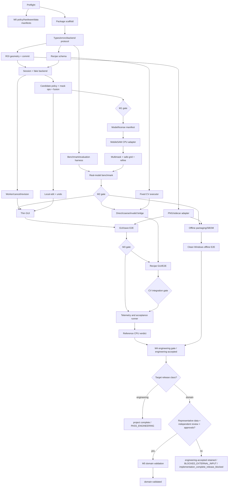

# SegVision v1 Autonomous AI-Agent Execution Protocol

> This document is operational. Behavioral requirements remain in `specs/*/spec.md`; implementation order is tracked in `tasks.md`.

## 1. Objective

An AI coding agent SHALL be able to resume this change, select the next runnable task, implement it, prove it, record evidence, and continue without asking the user for ordinary engineering preferences.

The agent SHALL remain honest about external gates. It may autonomously reach `engineering-accepted`; it may only claim `domain-validated` when approved representative data, independent gold/reviewer evidence, and required legal/release approvals exist.

## 2. Startup sequence

Every agent run performs, in order:

1. Read repository `AGENTS.md`.
2. Read `PRD.md`.
3. Read `docs/final-development-recommendation.md`.
4. Read this change's `proposal.md`, `design.md`, `specs/*/spec.md`, `e2e-acceptance.md`, and `tasks.md`.
5. Run `openspec validate build-segvision-v1 --strict --no-interactive`.
6. If the `SCAFFOLD` checkpoint exists, prepend the repository `.venv\Scripts` directory to the process `PATH` and prove `python` resolves to that CPython 3.11 x64 executable; never run project commands with an ambient host Python.
7. Read the current execution state and latest evidence manifests.
8. Inventory the worktree without deleting, resetting, stashing, or overwriting user changes.
9. Select the lowest-numbered unchecked task whose dependencies are satisfied.
10. Execute the task control loop.

If a source file changes while being inspected, the agent re-reads it before editing.

## 3. Execution state

Runtime state belongs under:

```text
evidence/execution-state.json
evidence/<run-id>/<task-id>/
```

`owned_paths` governs implementation writes. The controller has exactly two additional bookkeeping paths: `openspec/changes/build-segvision-v1/tasks.md` and `evidence/execution-state.json`. Only the controller may update them, only for the matching checkbox/state transition, and it SHALL do so atomically after validating the proposed transition. This exception does not authorize task implementation to edit any other path.

At P00, a new run creates one immutable ID in the form `sv-<UTC-YYYYMMDDTHHMMSSZ>-<8 lowercase hex>` and stores it in `execution-state.json`. The current process exposes that exact value as `SEG_RUN_ID`; a resumed agent reloads it from state rather than generating a new ID. Every command containing `$env:SEG_RUN_ID` MUST first prove that it equals the state `run_id`, and evidence validation MUST reject mixed run IDs.

Allowed task states:

```text
pending
runnable
running
passed
failed_retryable
blocked_external_input
blocked_license
blocked_reference_hardware
rejected
```

Only `passed` satisfies a dependency. A task becomes `passed` only when its declared outputs exist, focused tests pass, affected regression gates pass, evidence validates, and no prohibited shortcut occurred.

Source identity SHALL be stable under controller bookkeeping: the canonical maintained-source fingerprint excludes `.venv/`, `evidence/`, `dist/`, `build/`, and tool caches, normalizes only `tasks.md` checkbox markers to unchecked, and leaves every other maintained byte significant. Model/checkpoint and release artifacts are bound separately by their manifest hashes.

Run verdict, release classifications, and project state are separate. Every run declares `target_release_class=engineering|domain`, defaulting to `engineering` only when no explicit repository-owned target exists. `project_state` remains `in_progress` while independent work is runnable, becomes `complete` only with the target's passing verdict, becomes `implementation_complete_release_blocked` only after independent work is exhausted and an applicable external gate is unavailable, and becomes `failed` only after independent work is exhausted and a mandatory non-external gate is finally failed or rejected. `domain_validated=true` implies `engineering_accepted=true`.

## 4. Task control loop

For each task:

```text
read task + requirement refs + E2E refs
→ inspect owned files and related tests
→ record pre-task hashes/checkpoint
→ add or update focused failing tests
→ implement the smallest compliant behavior
→ run focused tests
→ run milestone regression tests
→ run static/type/schema gates
→ generate and validate evidence
→ update public docs/examples if behavior changed
→ mark task checkbox only after every gate passes
→ record post-task checkpoint
→ continue to next runnable task
```

The agent does not stop after producing a plan when an in-scope implementation task remains safe and runnable.

## 5. Task DAG

Milestones are canonical and fixed: M0 governance/scaffold; M1 pure core plus fake backend; M2 approved MobileSAM CPU backend; M3 runtime, GUI, and persistence; M4 fixed CV plus complete Tier A/B acceptance, offline package, and engineering verdict; M5 optional domain promotion. A missing M5 input never blocks an engineering-target completion.



M0 documentation and M1 pure core may proceed in parallel. Missing Tier C inputs never block M1 through M4 or an engineering-target completion.

## 6. Standard commands

The implementation SHALL expose stable repository-owned wrappers, but the baseline command contract is:

```powershell
openspec validate build-segvision-v1 --strict --no-interactive
python -m ruff check .
python -m mypy src\segvision
python -m pytest tests\unit -q
python -m pytest tests\integration -q
python -m pytest tests\e2e -q
python -m pytest tests\gui -q
python -m pytest -q
python -m segvision.acceptance validate-manifest openspec\changes\build-segvision-v1\acceptance\e2e-cases.json
python -m segvision.acceptance validate-contracts --change build-segvision-v1
python -m segvision.acceptance validate-evidence --evidence evidence\<run-id>\<task-id>\evidence.json
python -m segvision.acceptance validate-state --state evidence\execution-state.json
```

Reference-machine, model, GUI, packaging, and domain commands are introduced by their owning tasks and must be documented in `tasks.md` and the evidence manifest.

## 7. Evidence rule

Each passed task writes an `evidence.json` conforming to `acceptance/evidence.schema.json`, including:

- task and dependency IDs;
- source revision or full file-tree hash when Git is unavailable;
- dirty paths existing before the task;
- commands and exit codes;
- stdout/stderr hashes;
- output file hashes;
- test counts and failures;
- benchmark/quality values where applicable;
- retry history and distinct hypotheses;
- start/end timestamps;
- release-blocking warnings.

An agent SHALL NOT mark a task complete based solely on its own prose summary.

Before marking any `tasks.md` checkbox, the agent SHALL run `validate-contracts`, `validate-evidence` for that task's `evidence.json`, and `validate-state` for the proposed execution state. All three commands MUST exit zero and bind to the same source, task graph, contracts, and evidence hashes. Before emitting or changing a release verdict, the agent SHALL rerun `validate-contracts` and `validate-state` and SHALL run `validate-evidence` against the complete `evidence/<run-id>/` bundle. A missing, stale, or non-zero validator result forbids the checkbox or verdict.

The controller SHALL validate the proposed final state before atomically publishing the matching checkbox/state pair. If any validator fails, it SHALL restore the prior valid controller state and leave the checkbox unchecked; it MUST NOT leave a half-published transition.

## 8. Retry policy

| Failure | Allowed attempts | Required response |
|---|---:|---|
| Deterministic code/test failure | 3 materially different attempts | Record hypothesis and patch for each; then blocker/reject |
| Dependency conflict | 2 isolated-environment attempts | Select a compatible pinned set; do not globally unpin |
| Suspected flaky test | 1 diagnosis cycle + 20-repeat proof | Fix race/time dependency; rerun-until-green is forbidden |
| Official model download | 2 attempts | Verify URL; if unavailable, block model task and continue fake/core work |
| Checksum/license failure | 0 bypass attempts | Quarantine/block immediately |
| CPU SLO miss | 3 measured optimization hypotheses | Thread tuning/profile/local optimization; then reject backend or block hardware gate |
| GUI latency miss | 3 profiled rendering changes | Replace rendering layer only; do not rewrite core or move to web/GPU |
| CV recipe no benefit | 1 reproduction + report | Keep class recipe disabled |
| Save failure | session-preserving retry | Never mark Accepted or enable Next before a valid receipt |

Repeatedly running an identical command without a new hypothesis does not count as a valid attempt.

## 9. Checkpoint and rollback

- Before a task, record hashes of owned files and user-dirty files.
- Prefer one atomic commit per passed task when Git is available: `agent(<task-id>): <verified outcome>`.
- Roll back by a narrow reverse patch or `git revert` of the task commit.
- Never use `git reset --hard`, destructive checkout, broad recursive deletion, or cleanup of user-owned files.
- A task may not modify files outside its declared ownership unless `tasks.md` explicitly lists the shared file.
- Checkpoint reuse is path-scoped: task-graph and contract hashes, dependency checkpoint IDs, declared required-input hashes, and task-owned output hashes MUST still match. A later task's disjoint output, controller-managed checkbox/state bookkeeping, or volatile generated directory MUST NOT invalidate an otherwise matching checkpoint merely because the audit-only whole-tree snapshot changed.
- Checkpoint/model caches are content-addressed; checksum failures move to quarantine.
- Accepted annotation test artifacts live only in task-scoped temporary directories.
- A failed release never overwrites the prior release bundle or evidence.

## 10. Prohibited shortcuts

The agent SHALL NOT:

- edit the frozen PRD or lower OpenSpec thresholds to make tests pass;
- add GPU, cloud inference, remote service, VLM, DINO, SAM 2/3, HQ-SAM, or multi-provider hot paths;
- default to OR/fusion or auto-Accept;
- expose per-image HSV/Lab controls;
- let GUI code handle tensors, embeddings, logits, preprocessing, or mask-state conversion;
- re-encode during SAM point refinement;
- lazy-encode `cv_direct` or manual candidates;
- merge a late model result over local edits;
- show more than three candidates or clone masks to fill slots;
- publish Needs Review as training data;
- accept a partial/corrupt PNG-sidecar pair;
- load an unknown, unapproved, or checksum-mismatched checkpoint;
- use EdgeSAM commercially without recorded permission;
- copy unapproved GPL code/assets;
- fabricate target-machine performance, gold truth, human Accept, reviewer outcome, user study, license approval, or release signoff;
- hide failed/timeout/review cases from aggregate metrics;
- mark a task complete with skipped required tests.

## 11. Escalation boundary

The agent proceeds with documented defaults and does not ask about module naming, minor UI layout, test framework details, internal implementation, or routine bug fixes.

It stops only for:

1. destructive or irreversible action outside task-generated artifacts;
2. a direct PRD/OpenSpec contradiction that changes public behavior;
3. absent commercial-use/redistribution authority for a required artifact;
4. required official checkpoint unavailable or checksum-invalid after allowed retries;
5. absent reference hardware for a hard Tier B verdict;
6. absent representative data, independent gold/reviewer evidence, or signoff for Tier C;
7. privacy/security restrictions that prohibit using the available data;
8. a hard physical performance gate still impossible after allowed measured optimization attempts.

Blocker output SHALL contain:

```text
task_id
gate_id
blocker_class
observed evidence
attempts and hypotheses
safe alternatives already tried
exact missing input or authority
tasks that remain runnable
earliest milestone affected
safe state if no response arrives
```

When the same external blocker recurs, the agent records it once, continues every independent task, and does not repeatedly ask the user.

## 12. Completion

### Engineering completion

Every run SHALL declare `target_release_class=engineering|domain`; when no explicit repository-owned target exists, the run SHALL use `engineering`. The canonical milestones are M0 governance/scaffold, M1 pure core plus fake backend, M2 approved MobileSAM CPU backend, M3 runtime/GUI/persistence, M4 fixed CV plus complete Tier A/B acceptance/offline package/engineering verdict, and M5 optional domain promotion.

An engineering-target `engineering-accepted` completion requires:

- all M0 through M4 engineering tasks and mandatory Tier A/B cases pass;
- all mandatory Tier B model/reference CPU/offline/package cases pass;
- OpenSpec strict validation passes;
- evidence manifests validate;
- approved model/dependency manifests have no blocking entry;
- release verdict is `PASS_ENGINEERING`.

Missing Tier C or M5 inputs are not applicable to an engineering target and MUST NOT change `PASS_ENGINEERING` into a blocked or failed verdict.

### Domain completion

A domain-target `domain-validated` completion additionally requires M5 and:

- approved representative dataset and independent gold/reviewer source;
- Tier C case and all profile thresholds pass;
- real human outcomes are not simulated;
- release/legal approval references exist;
- release verdict is `PASS_DOMAIN_VALIDATED`.

For a domain target whose M0 through M4 engineering gates pass but a required Tier C promotion input is absent, the candidate SHALL retain `engineering_accepted=true`, SHALL keep `domain_validated=false`, SHALL emit the applicable `BLOCKED_EXTERNAL_INPUT`, `BLOCKED_LICENSE`, or `BLOCKED_REFERENCE_HARDWARE` verdict, and SHALL use `project_state=implementation_complete_release_blocked`. This is not a software failure or a domain release.

The run SHALL emit `FAIL` with `project_state=failed` only after every independent runnable task has been exhausted and a mandatory non-external gate remains finally failed, or its owning task is `rejected`, after the allowed materially different attempts. Until that condition holds, the project remains `in_progress` even if an individual task has failed or is retryable.

No task checkbox and no release verdict is valid until the mandatory `validate-contracts`, `validate-evidence`, and `validate-state` commands in Section 6 have passed for the applicable task or run bundle.
